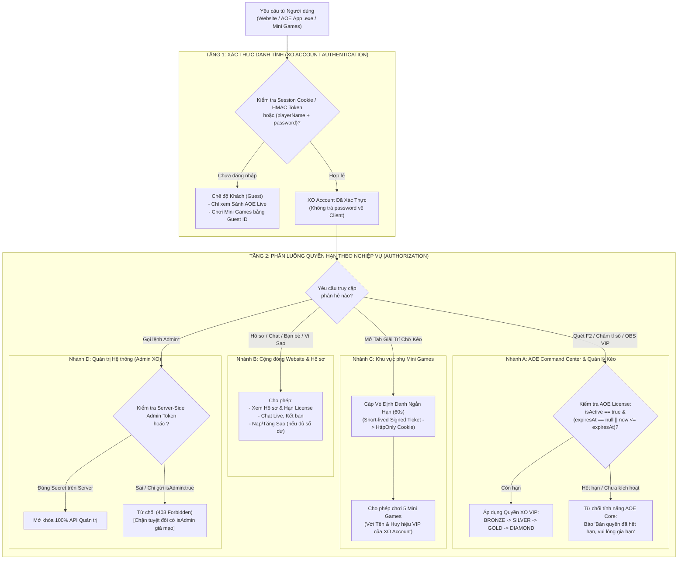

# 🔐 KIẾN TRÚC TÀI KHOẢN XO, PHÂN QUYỀN VIP & BẢN QUYỀN AOE (`ACCOUNT_LICENSE_ARCHITECTURE.md`)

> **Giai đoạn:** TASK 2 — Thiết Kế Hệ Thống Tài Khoản, Xác Thực & Bản Quyền (Chưa can thiệp mã nguồn)  
> **Nguyên tắc bảo mật cốt lõi:**  
> 1. Tách bạch **XO Account (Danh tính)** và **AOE License (Bản quyền phần mềm)**.  
> 2. Không dùng tên người chơi hay dữ liệu `localStorage` đơn thuần làm bằng chứng xác thực.  
> 3. Tuyệt đối không trả mật khẩu hay thông tin bí mật về Frontend.  
> 4. Không lưu token xác thực dài hạn trên thanh địa chỉ URL.  
> 5. Không ghi bất kỳ mật khẩu, token hay secret thực tế nào vào tài liệu này.

---

## 1. HIỆN TRẠNG HỆ THỐNG TÀI KHOẢN & LICENSE (CURRENT STATE)

### 1.1. Cấu Trúc Dữ Liệu Hiện Tại Trong `server/db.js`
Hiện tại, bảng `players` trong [`server/db.js`](file:///c:/Users/APC/.gemini/antigravity/scratch/aoetrackerv2/server/db.js#L186-L197) đang gộp chung cả thông tin tài khoản và bản quyền trên cùng một bản ghi:
- **Định danh & Bảo mật**: `name` (Khóa chính), `password` (Đang lưu dạng văn bản thuần).
- **Trạng thái Bản quyền (AOE License)**: `is_active` (Boolean), `activated_at` (BigInt ms), `expires_at` (BigInt ms hoặc `null` nếu vĩnh viễn).
- **Hạng Thành viên & Cấu hình (XO VIP)**: `tier` (`'BRONZE'` | `'SILVER'` | `'GOLD'` | `'DIAMOND'`), `overlay_config` (JSONB).
- **Kinh tế Cộng đồng & Xã hội**: `social_data` (JSONB chứa `friends`, `starsBalance`, `starsReceived`, `starHistory`, `vipHistory`, `lastSeenAt`).

### 1.2. Các Lỗ Hổng Bảo Mật Hiện Tại Cần Khắc Phục Trong Kiến Trúc Mục Tiêu
1. **Lộ mật khẩu trong API công khai (`WEB-02`)**: Hàm `getInitialDataPayload()` trong [`server/index.js`](file:///c:/Users/APC/.gemini/antigravity/scratch/aoetrackerv2/server/index.js#L462-L547) đang trả nguyên trường `password` của mọi người chơi về trình duyệt.
2. **Giả mạo quyền Admin (`WEB-01`)**: Hàm `isAdminAuthorized(data)` tại [`server/index.js:235`](file:///c:/Users/APC/.gemini/antigravity/scratch/aoetrackerv2/server/index.js#L235) có dòng `if (data.isAdmin) return true;` cho phép vượt quyền Admin mà không cần mật khẩu/token Admin.
3. **Chặn cứng toàn bộ tài khoản hết hạn ngay ở bước đăng nhập**: Hàm `validatePlayerAccount()` hiện tại từ chối đăng nhập nếu `now > expiresAt`, khiến người dùng hết hạn License AOE không thể đăng nhập lên Website để xem lịch sử của mình hoặc chơi Mini Games.

---

## 2. KIẾN TRÚC ĐỀ XUẤT: TÁCH BẠCH "XO ACCOUNT" VÀ "AOE LICENSE"

### 2.1. Định Nghĩa Rõ Hai Khái Niệm Độc Lập Về Mặt Logic (Trên Cùng Bảng `players`)

Không cần tách hay đập bỏ bảng `players` hiện có trong PostgreSQL; thay vào đó, hệ thống phân tách ở **tầng kiểm tra nghiệp vụ (Domain Validation Layer)**:

| Khái niệm | Mục đích | Điều kiện hợp lệ | Phạm vi áp dụng |
| :--- | :--- | :--- | :--- |
| **1. XO Account (Danh tính Hệ sinh thái)** | Định danh cá nhân của người dùng trên toàn hệ sinh thái XO. | - Tên tài khoản tồn tại (`players.name`). - Mật khẩu (hoặc Session Token chữ ký HMAC) hợp lệ. - Tài khoản không bị khóa kỷ luật (`isBlocked !== true`). | - Đăng nhập trên **XO Website**. - Xem Hồ sơ cá nhân & ngày hết hạn. - Trò chuyện trên Sảnh Chat, kết bạn, tặng Sao. - Chơi **XO Mini Games** dưới tên chính chủ. |
| **2. AOE License (Bản quyền Phần mềm AOE Command Center)** | Quyền sử dụng thương mại đối với phần mềm Windows **AOE Command Center** và **OBS Overlays**. | - `XO Account` hợp lệ **VÀ** - `isActive === true` **VÀ** - (`expiresAt === null` HOẶC `Date.now() <= expiresAt`). | - Đăng nhập và mở khóa tính năng quét `Diplomacy (F2)` trên **AOE Command Center (`.exe`)**. - Tạo/cập nhật kèo đấu (`autoAddGame`, `setWinner`, `triggerHypeShout`). - Áp dụng cấu hình **OBS VIP** (`updateOverlayConfig`). |

### 2.2. Sơ Đồ Luồng Xác Thực, Kiểm Tra License & Phân Quyền

---

## 3. CHI TIẾT CƠ CHẾ ĐĂNG NHẬP & BẢO VỆ SESSION TRÊN TỪNG NỀN TẢNG

### 3.1. Đăng Nhập Trên XO Website
- Người dùng nhập `playerName` và `password` vào Modal Đăng nhập.
- Server kiểm tra thông tin tại `verifyPlayerLogin`:
  - Nếu đúng mật khẩu: Server tạo một **Session Token có chữ ký HMAC-SHA256** (`<SESSION_HMAC_SECRET>`) chứa `{ sub: playerName, role: 'player', iat, exp }` và trả về qua **HttpOnly Cookie (`SameSite=Lax`)** kèm thông tin hiển thị công khai (`name`, `tier`, `isActive`, `expiresAt`, `daysLeft`, `starsBalance`).
  - **Không lưu mật khẩu dạng văn bản thuần vào `localStorage` của trình duyệt.**
  - Nếu tài khoản đã hết hạn `AOE License` (`now > expiresAt`), người dùng vẫn có thể xem trang **Hồ sơ cá nhân** trên Website để biết ngày hết hạn và liên hệ gia hạn, thay vì bị văng lỗi không xem được thông tin.

### 3.2. Đăng Nhập Trên Phần Mềm AOE Command Center (`.exe`) — Tương Thích Ngược 100%
- Để đảm bảo **không bắt buộc người dùng đang chạy bản `.exe` hiện tại phải cập nhật lại ngay lập tức**:
  - Server vẫn chấp nhận phương thức xác thực bằng `playerName` + `password` trong body `POST /api` đối với các request từ App PC, **NHƯNG** bắt buộc kiểm tra đầy đủ **cả XO Account lẫn AOE License (`isActive && !isExpired`)** trước khi cho phép mở màn hình điều khiển chính hoặc gọi `autoAddGame`, `setWinner`, `heartbeat`.
  - Ở các bản cập nhật `.exe` tiếp theo, App PC sẽ lưu `sessionToken` nhận từ `verifyPlayerLogin` thay vì gửi lại mật khẩu ở mỗi chu kỳ `heartbeat`.

### 3.3. Đăng Nhập & Định Danh Tại Khu Vực Mini Games (Không Lưu Token Dài Hạn Trong URL)
- **Với Khách chưa đăng nhập (Guest)**:
  - Có thể chơi ngay **Rắn săn mồi** và **2048** trên trình duyệt, hoặc vào **Caro / Sudoku / Cờ vua** với mã định danh khách ngẫu nhiên (`Guest Token` trong `sessionStorage`).
- **Với Người dùng đã đăng nhập XO Account**:
  - Tuyệt đối **không lấy tên từ `localStorage` đơn thuần làm bằng chứng xác thực** (vì bất kỳ ai cũng có thể sửa `localStorage.setItem('aoe_playerName', 'XO')` trên F12 Console để mạo danh!).
  - Tuyệt đối **không gắn token phiên dài hạn lên URL** (`?token=...`) để tránh lộ trong lịch sử trình duyệt hoặc header `Referer`.
  - **Cơ chế chuẩn (One-Time Short-Lived Ticket / Same-Origin Cookie)**:
    1. Khi người dùng mở tab `"🎮 Giải Trí Chờ Kèo"`, nếu cùng tên miền (qua Reverse Proxy), trình duyệt tự động gửi kèm `HttpOnly Session Cookie` đã ký HMAC để xác thực tên người chơi.
    2. Nếu chạy khác cổng/tên miền phụ, Server Website cấp một **Vé dùng 1 lần có thời hạn 30 giây (`One-Time Ticket`)** qua API `POST /api` (`action: 'issueMiniGameTicket'`). Khung Mini Games gửi vé này qua `POST` để đổi lấy phiên `HttpOnly Cookie` riêng của Mini Games và hủy vé ngay lập tức.

### 3.4. Phân Quyền Admin An Toàn Phía Server (Server-Side Admin Guard)
- Xóa bỏ hoàn toàn logic tin tưởng cờ `if (data.isAdmin) return true;` trong [`server/index.js:235`](file:///c:/Users/APC/.gemini/antigravity/scratch/aoetrackerv2/server/index.js#L235).
- Một request chỉ được công nhận là **Admin** khi và chỉ khi thỏa mãn 1 trong 2 điều kiện kiểm tra trực tiếp trên Server:
  1. Gửi kèm `adminPassword` khớp chính xác với biến môi trường `<ADMIN_PASSWORD_ENV>` trên Server (dùng `crypto.timingSafeEqual` để chống tấn công đo thời gian).
  2. Hoặc có `Admin Session Token` do Server ký số sau khi đăng nhập qua `verifyAdminLogin`.
- Xóa hoàn toàn các dòng so khớp chuỗi mật khẩu Admin cứng bên trong [`public/index.html`](file:///c:/Users/APC/.gemini/antigravity/scratch/aoetrackerv2/public/index.html#L2728).

---

## 4. BẢNG PHÂN QUYỀN CHI TIẾT TRONG HỆ SINH THÁI (RBAC MATRIX)

| Hành động / Tính năng | Khách (Guest) | XO Account (Hết hạn License AOE) | XO Account + License Đồng (`BRONZE`) | VIP Bạc (`SILVER`) | VIP Vàng (`GOLD`) | VIP Kim Cương (`DIAMOND`) | Admin XO |
| :--- | :---: | :---: | :---: | :---: | :---: | :---: | :---: |
| Xem Sảnh AOE Live, Thống kê Quân, Tải Tool `.exe` | ✅ | ✅ | ✅ | ✅ | ✅ | ✅ | ✅ |
| Xem Hồ sơ cá nhân, Đổi mật khẩu, Xem hạn License | ❌ | ✅ | ✅ | ✅ | ✅ | ✅ | ✅ |
| Chat trên Sảnh AOE Live, Kết bạn, Tặng Vật phẩm Sao | ❌ | ✅ | ✅ | ✅ | ✅ | ✅ | ✅ |
| Chơi 5 Mini Games (`Caro, Sudoku, Cờ vua, Rắn, 2048`) | ✅ *(Tên khách)* | ✅ *(Tên chính chủ)* | ✅ *(Kèm huy hiệu)* | ✅ *(Kèm huy hiệu)* | ✅ *(Kèm huy hiệu)* | ✅ *(Kèm huy hiệu)* | ✅ |
| Đăng nhập App PC & Quét bảng quân `Diplomacy (F2)` | ❌ | ❌ | ✅ | ✅ | ✅ | ✅ | ✅ |
| Chấm tỉ số `F5`/`F6`, Hoàn tác, Hiệu ứng `F8` | ❌ | ❌ | ✅ | ✅ | ✅ | ✅ | ✅ |
| Tùy chỉnh OBS: Điểm chạm (`Chạm X`) & Ngày tháng | ❌ | ❌ | ❌ | ✅ | ✅ | ✅ | ✅ |
| Tùy chỉnh OBS: Chữ chạy `Marquee` & Quảng cáo riêng | ❌ | ❌ | ❌ | ❌ | ✅ | ✅ | ✅ |
| Tùy chỉnh OBS: Đánh theo `C` (`Séc 1, 2, 3...`) | ❌ | ❌ | ❌ | ❌ | ❌ | ✅ | ✅ |
| Quản lý User, Gia hạn VIP, Nạp Sao, Xóa lịch sử đấu | ❌ | ❌ | ❌ | ❌ | ❌ | ❌ | ✅ |

---

## 5. LÝ DO LỰA CHỌN, ƯU ĐIỂM, NHƯỢC ĐIỂM, RỦI RO & ROLLBACK

- **Lý do lựa chọn**: Giải quyết triệt để 3 lỗ hổng bảo mật lớn nhất (`WEB-01`, `WEB-02`, `WEB-03`) đồng thời mở đường cho việc dùng chung 1 tài khoản XO duy nhất giữa Website, AOE Command Center và Mini Games mà **không phải sửa cấu trúc bảng `players` trong PostgreSQL**.
- **Ưu điểm**:
  - Bảo toàn 100% cơ chế kiểm tra hạn dùng `expiresAt` và phân hạng `tier` của phần mềm AOE Command Center.
  - Chặn đứng nguy cơ lộ mật khẩu người dùng qua tab Network F12 và nguy cơ mạo danh tên người chơi trong Mini Games.
- **Nhược điểm**:
  - Cần bổ sung hàm ký/kiểm tra HMAC token (dùng module `crypto` có sẵn của Node.js, không cần cài thêm thư viện ngoài).
- **Rủi ro & Kiểm soát**:
  - *Rủi ro*: Nếu khóa ngay lập tức phương thức gửi `playerName + password` trên `/api`, các bản `.exe` cũ chưa cập nhật sẽ không gửi được `autoAddGame`.
  - *Kiểm soát*: Giữ hỗ trợ song song (Dual-Auth Support): chấp nhận cả `HMAC Session Token` (cho Web mới) VÀ `playerName + password` trong body `POST /api` (cho App PC `.exe`), trong khi luôn ẩn `password` ở chiều trả về `GET /api`.
- **Các module bị ảnh hưởng**: [`server/index.js`](file:///c:/Users/APC/.gemini/antigravity/scratch/aoetrackerv2/server/index.js) và [`public/index.html`](file:///c:/Users/APC/.gemini/antigravity/scratch/aoetrackerv2/public/index.html).
- **Phương án Rollback**: Giữ nguyên cấu trúc bảng `players` trong DB nên có thể rollback code xác thực trong `server/index.js` bất kỳ lúc nào mà không làm hỏng dữ liệu tài khoản.

