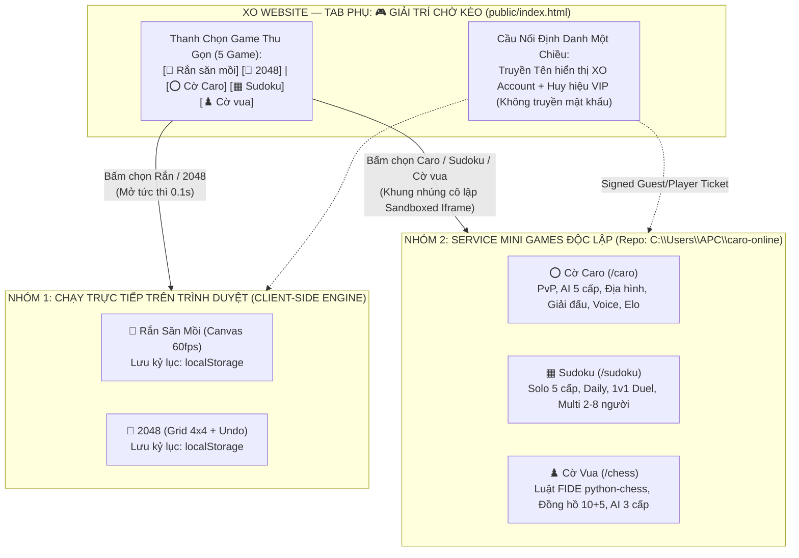

# 🎮 THIẾT KẾ KIẾN TRÚC & PHƯƠNG ÁN TÍCH HỢP MINI GAMES (`MINIGAMES_INTEGRATION_DESIGN.md`)

> **Giai đoạn:** TASK 2 — Thiết Kế Tích Hợp Mini Games Chuyên Sâu (Chưa can thiệp mã nguồn)  
> **Phạm vi 5 Game đã chốt:** **1. Cờ Caro** • **2. Sudoku** • **3. Cờ vua** • **4. Rắn săn mồi** • **5. 2048**  
> *(Loại bỏ `Đào Mỏ Kiểu OEV` và `CEO's Survival` khỏi phạm vi hiển thị).*

---

## 1. HIỆN TRẠNG KỸ THUẬT CỦA 5 MINI GAMES (CURRENT STATE ANALYSIS)

Để không đưa ra quyết định cảm tính, bảng dưới đây mổ xẻ chính xác kiến trúc thực tế của từng game trong [`C:\Users\APC\caro-online`](file:///C:/Users/APC/caro-online):

| Tiêu chí kỹ thuật | 1. Cờ Caro (`/caro`) | 2. Cờ vua (`/chess`) | 3. Sudoku (`/sudoku`) | 4. Rắn săn mồi (`/snake`) | 5. 2048 (`/2048`) |
| :--- | :--- | :--- | :--- | :--- | :--- |
| **File nguồn hiện tại** | [`caro_lan.py`](file:///C:/Users/APC/caro-online/caro_lan.py) + [`voice.py`](file:///C:/Users/APC/caro-online/games/voice.py) + [`voice.js`](file:///C:/Users/APC/caro-online/games/voice.js) | [`games/chess.py`](file:///C:/Users/APC/caro-online/games/chess.py) + [`games/pages.py`](file:///C:/Users/APC/caro-online/games/pages.py) | [`sudoku.py`](file:///C:/Users/APC/caro-online/games/sudoku.py), [`sudoku_duel.py`](file:///C:/Users/APC/caro-online/games/sudoku_duel.py), [`sudoku_history.py`](file:///C:/Users/APC/caro-online/games/sudoku_history.py), [`sudoku_page.py`](file:///C:/Users/APC/caro-online/games/sudoku_page.py) | [`games/arcade_pages.py`](file:///C:/Users/APC/caro-online/games/arcade_pages.py#L15-L26) (`SNAKE_HTML`) + [`arcade_scores.py`](file:///C:/Users/APC/caro-online/games/arcade_scores.py) | [`games/arcade_pages.py`](file:///C:/Users/APC/caro-online/games/arcade_pages.py#L3-L13) (`GAME_2048_HTML`) + [`arcade_scores.py`](file:///C:/Users/APC/caro-online/games/arcade_scores.py) |
| **Có chạy độc lập 100% trên trình duyệt được không?** | **Không** (Nếu chuyển sang JS tĩnh sẽ mất toàn bộ hệ thống phòng chơi PvP, Giải đấu, Bot AI 5 cấp độ ở Python, Elo Radar và Voice Chat). | **Không** (Toàn bộ kiểm tra nước đi hợp lệ FIDE, chiếu hết, hòa 75 nước/5 lần lặp và AI Alpha-Beta nằm trong `python-chess` phía Backend). | **Một phần** (Solo có thể chạy JS, nhưng sinh bảng duy nhất 1 nghiệm, Daily Challenge đồng bộ toàn server, Đấu 1v1 và Đua 2–8 người nằm ở Python Backend). | **CÓ (100%)** — Toàn bộ vòng lặp game, vẽ Canvas 60fps, va chạm, âm thanh và lưu kỷ lục cá nhân (`localStorage`) nằm gọn trong JS trình duyệt. | **CÓ (100%)** — Toàn bộ logic trượt/gộp ô 4×4, hoàn tác `Ctrl+Z`, âm thanh WebAudio và lưu kỷ lục cá nhân (`localStorage`) nằm gọn trong JS trình duyệt. |
| **Có cần Backend không?** | **Bắt buộc** (`caro_lan.py` xử lý `/state`, `/move`, `/new`, `/draw`, `/tourn_*`, `/api/tts`). | **Bắt buộc** (`games/chess.py` xử lý `/chess/state`, `/chess/move`, `/chess/offer_draw`, `/chess/claim_draw`). | **Bắt buộc** cho Daily Challenge, Speedrun Leaderboard, 1v1 Duel & Multi 2–8 người. | **Không bắt buộc** (Chỉ cần API nhẹ nếu muốn lưu Bảng xếp hạng chung toàn server). | **Không bắt buộc** (Chỉ cần API nhẹ nếu muốn lưu Bảng xếp hạng chung toàn server). |
| **Có cần Multiplayer & Đồng bộ Realtime không?** | **Có** (Phòng chơi 2 người + Khán giả xem trực tiếp + Giải đấu vòng tròn + Kênh chat/ném cà chua). | **Có** (Phòng chơi 2 người + Khán giả + Đồng hồ 10+5 đếm ngược phía server). | **Có** (Chế độ 1v1 Duel thanh kéo co tiến độ & Multi Race 2–8 người trong `sudoku_duel.py`). | **Không** (Game 1 người chơi). | **Không** (Game 1 người chơi). |
| **Cơ chế Realtime hiện tại** | HTTP Polling chu kỳ ngắn (`500ms` khi trong bàn, `2000ms` ở sảnh) + WebRTC Mesh (`voice.py`) cho giọng nói. | HTTP Polling chu kỳ `800ms` tới `/chess/state`. | HTTP Polling (`1000ms` ở chế độ Duel/Multi) + Timer cục bộ. | Không cần mạng khi đang chơi. | Không cần mạng khi đang chơi. |
| **Lưu tiến trình & Bảng xếp hạng** | Bảng `games`, `tournaments`, `caro_kv_store` (Postgres) / `caro_scores.json`. Tính điểm Elo & Radar 5 chiều. | Lưu 500 ván gần nhất vào `chess_games.json`. | Bảng `sudoku_scores`, `sudoku_daily_streaks` (Postgres) + `sudoku_history.json` (10 danh hiệu). | Lưu `localStorage.xo_snake_best` + Bảng `arcade_snake_scores`. | Lưu `localStorage.xo_2048_best` + Bảng `arcade_2048_scores`. |

---

## 2. PHÂN TÍCH CHUYÊN SÂU TỪNG NHÓM GAME ĐẶC THÙ

### 2.1. Phân Tích Riêng: Cờ Caro (`/caro`) và Cờ Vua (`/chess`)
Tại sao **không thể** chỉ chuyển Caro và Cờ vua sang JavaScript tĩnh nếu muốn giữ nguyên chất lượng hiện có:
1. **Phòng chơi nhiều người & Đồng bộ lượt chơi chống gian lận**:
   - Trong [`caro_lan.py`](file:///C:/Users/APC/caro-online/caro_lan.py#L3297-L3358) và [`games/chess.py`](file:///C:/Users/APC/caro-online/games/chess.py#L335-L388), máy chủ Python đóng vai trò trọng tài duy nhất (Server-Authoritative): giữ đồng hồ đếm ngược (`30s/nước` ở Caro, `10 phút + 5s` ở Cờ vua), kiểm tra quyền đi quân qua `token` bí mật của từng ghế (`X`/`O` hoặc `w`/`b`), và kiểm tra điều kiện thắng/hòa.
2. **Hệ thống AI & Hệ sinh thái Bot tự đấu**:
   - Caro sở hữu hơn 1.000 dòng thuật toán AI (`caro_lan.py:891–1940`) với 5 cấp độ, 6 cấu hình tính cách (`fast`, `attack`, `defense`, `balanced`...), thời gian suy nghĩ phi tuyến tính giống người thật (`compute_thinking_time`) và hệ thống các Bot tự mở bàn đấu với nhau (`tick_bot_duels`).
   - Cờ vua sử dụng thư viện C/Python chuẩn quốc tế `python-chess` để kiểm tra luật FIDE (bắt tốt qua đường, nhập thành khi không bị chiếu đi qua ô kiểm soát, hòa 75 nước, hòa lặp 5 lần, hòa khi hết giờ nhưng đối phương thiếu quân chiếu hết) kèm thuật toán Minimax Alpha-Beta.
3. **Voice Chat WebRTC & Thuyết minh TTS**:
   - Module [`games/voice.py`](file:///C:/Users/APC/caro-online/games/voice.py) làm trạm trung chuyển tín hiệu SDP/ICE (`offer`, `answer`, `ice`) cho đàm thoại giọng nói trực tiếp trong bàn cờ.
4. **Giải đấu vòng tròn (`Round-Robin`) & Hệ thống Elo / Biểu đồ Radar**:
   - Tự động chia cặp đấu vòng tròn, đổi bên X/O sau mỗi ván, phân định thắng thua bằng tổng thời gian suy nghĩ nếu hòa 1–1 (`tourn_resolve`), và tính toán biểu đồ mạng nhện 5 chỉ số (`speed`, `attack`, `defense`, `center_pct`, `x_pct`).
5. **Khôi phục phòng khi mất kết nối**:
   - Người chơi giữ `token` trong `localStorage`; khi tải lại trang hoặc rớt mạng tạm thời trong thời gian cho phép, server tự động gắn lại đúng ghế đang ngồi mà không làm mất ván cờ đang đánh.

### 2.2. Phân Tích Riêng: Sudoku (`/sudoku`)
Sudoku trong repo hiện tại không phải là một bảng tĩnh đơn giản mà gồm 4 chế độ liên kết chặt chẽ:
1. **Chế độ Solo (5 độ khó: Dễ → Ác mộng)**: Cần thuật toán sinh bảng bitmask đảm bảo **duy nhất 1 nghiệm** (`_count_solutions == 1` trong [`games/sudoku.py`](file:///C:/Users/APC/caro-online/games/sudoku.py#L256-L275)) và bộ gợi ý giải thích chiến thuật (*Naked Single* / *Hidden Single*).
2. **Thử thách hằng ngày (Daily Challenge)**: Dùng hạt giống định sẵn theo ngày (`xo-sudoku-daily:YYYY-MM-DD`) trên server để mọi người chơi giải cùng một đề và tính chuỗi ngày liên tiếp (`current_streak`, `best_streak`).
3. **Chế độ 1v1 Duel & Multiplayer 2–8 người ([`games/sudoku_duel.py`](file:///C:/Users/APC/caro-online/games/sudoku_duel.py))**:
   - Server tạo cùng một đề bài cho tất cả người chơi trong phòng, kiểm tra từng nước đi: nếu điền sai sẽ khóa bảng 3 giây (`PENALTY_SECONDS = 3`), nếu điền đúng sẽ cập nhật thanh kéo co tiến độ thời gian thực và mặt nạ ô đã điền (`mask`) của đối thủ mà không lộ con số.

### 2.3. Phân Tích Riêng: Rắn Săn Mồi (`/snake`) và 2048 (`/2048`)
- Cả hai trò chơi này trong [`games/arcade_pages.py`](file:///C:/Users/APC/caro-online/games/arcade_pages.py) đều là **100% Client-Side HTML5/JS** (khoảng 120–180 dòng JS mỗi game), không có phòng chờ, không có trạng thái ván chơi trên server.
- Chúng có thể chạy trực tiếp ngay bên trong trình duyệt của XO Website với độ trễ bằng 0 và không tiêu tốn bất kỳ tài nguyên CPU/RAM nào của máy chủ.

---

## 3. SO SÁNH 3 PHƯƠNG ÁN KIẾN TRÚC TÍCH HỢP (ARCHITECTURAL COMPARISON)

Dưới đây là bảng đối chiếu khách quan 3 phương án kiến trúc để tích hợp 5 Mini Games vào XO Website:

| Tiêu chí đánh giá | Phương án A: Tích hợp Thuần Trình Duyệt (Pure Static Browser Integration) | Phương án B: Service Mini Games Độc Lập Hoàn Toàn (Full Isolated Micro-Service) | Phương án C: Kiến Trúc Kết Hợp — Hybrid (Game nhẹ chạy trực tiếp trên Web + Game đối kháng chạy trên Service `caro-online` độc lập) |
| :--- | :--- | :--- | :--- |
| **Mô tả kỹ thuật** | Nhúng toàn bộ 5 game dưới dạng Javascript tĩnh chạy ngay trong `public/` của XO Website (`aoetrackerv2`), không chạy service Python `caro_lan.py`. | Giữ nguyên toàn bộ 5 game trên service Python `caro_lan.py` độc lập; XO Website nhúng sảnh Mini Games qua khung cô lập (`iframe` bảo mật / Reverse Proxy `/minigames/*`). | - **Rắn săn mồi & 2048**: Chạy trực tiếp bằng JS tĩnh trên XO Website (luôn sẵn sàng tức thì). - **Caro, Cờ vua & Sudoku**: Giữ nguyên trên service Python `caro_lan.py` độc lập và kết nối vào tab `"🎮 Giải Trí Chờ Kèo"` kèm cơ chế Fallback thông minh. |
| **1. Khả năng giữ nguyên tính năng hiện có** | **Kém (Chỉ đạt ~40%)**: Giữ được 100% Rắn & 2048, nhưng **Caro, Cờ vua, Sudoku bị mất hoàn toàn**: Phòng chơi PvP, Giải đấu, Voice Chat, AI `python-chess`, Sudoku 1v1/Multi và Elo Radar (hoặc phải viết lại hàng nghìn dòng code từ Python sang JS, vi phạm nguyên tắc không viết lại code đang chạy tốt). | **Tuyệt đối (100%)**: Giữ nguyên toàn bộ tính năng PvP, AI, Giải đấu, Voice Chat, Daily Challenge, 1v1 Duel của cả 5 game mà không phải viết lại logic. | **Tuyệt đối (100%)**: Giữ trọn vẹn 100% tính năng nâng cao của Caro, Cờ vua, Sudoku trên service Python, đồng thời giúp Rắn & 2048 mở tức thì ngay trên trình duyệt không cần đợi server. |
| **2. Chi phí vận hành** | **Thấp nhất**: Chỉ cần 1 Web Service Node.js hiện tại trên Render. | **Trung bình**: Cần chạy thêm 1 Web Service Python (hoặc 1 tiến trình phụ) cho `caro_lan.py`. | **Linh hoạt & Tối ưu**: Chạy 1 Web Service Node.js chính + 1 Service Python độc lập cho cụm game đối kháng (ngay cả khi Service Python ở gói Free đang ngủ/cold-start thì người dùng vẫn chơi được ngay Rắn & 2048 trong lúc chờ!). |
| **3. Hiệu năng (Performance)** | Nhanh với game đơn, nhưng nếu chạy AI Cờ vua / sinh bảng Sudoku nặng trên trình duyệt máy yếu sẽ gây giật khung hình Web AOE. | Tốt, toàn bộ tính toán AI Cờ vua/Caro nằm ở tiến trình Python riêng, không ăn vào CPU của Node.js AOE Server. | **Tối ưu nhất**: Tải của Rắn & 2048 bằng 0 trên cả 2 server; tải của Caro/Cờ vua/Sudoku nằm riêng bên tiến trình Python. |
| **4. Bảo mật (Security)** | Bề mặt tấn công nhỏ vì không có API phòng chơi, nhưng khó chống gian lận điểm số. | Cô lập tiến trình ở mức hệ điều hành. Cần vá lỗi `/reset` (`MG-01`) và XSS (`MG-02`) trên `caro_lan.py`. | Cô lập tiến trình ở mức hệ điều hành + Tách biệt quyền hạn rõ ràng (sau khi vá `MG-01` & `MG-02`). |
| **5. Khả năng mở rộng (Scalability)** | Rất hạn chế, không thể mở rộng các tính năng thi đấu cộng đồng (Giải đấu Caro, Đua Sudoku). | Dễ dàng nâng cấp hoặc chuyển cụm Mini Games sang server khác mà không chạm vào XO Website. | Cao nhất — Mở rộng từng nhóm game theo đúng bản chất kỹ thuật của chúng. |
| **6. Độ phức tạp triển khai** | Cao nếu cố viết lại Caro/Cờ vua/Sudoku sang JS; Thấp nếu cắt bỏ tính năng multiplayer. | Thấp — Giữ nguyên repo `C:\Users\APC\caro-online`, chỉ cần cấu hình giao diện đồng bộ và truyền định danh. | **Trung bình - Thấp** — Không phải viết lại bất kỳ thuật toán game nào; chỉ đóng gói UI tab `"🎮 Giải Trí Chờ Kèo"` kết nối 2 chế độ mượt mà. |
| **7. Ảnh hưởng tới AOE Command Center** | Thấp (nhưng làm phình to thư mục `public/` của repo AOE nếu nhồi nhét hết vào). | **Rất thấp (Đã cô lập tiến trình & dữ liệu)** tới mã nguồn, tiến trình hay Database của AOE Command Center. | **Rất thấp (Đã cô lập tiến trình & dữ liệu)** tới tiến trình, API hay Database của AOE Command Center. |
| **8. Khả năng Rollback** | Phức tạp hơn nếu trộn nhiều file game vào repo `aoetrackerv2`. | **Rất nhanh**: Chỉ cần ngắt liên kết sang service Mini Games. | **Rất nhanh**: Có thể tắt từng game hoặc tắt toàn bộ tab `"🎮 Giải Trí Chờ Kèo"` bằng 1 cờ cấu hình. |

---

## 4. ĐỀ XUẤT LỰA CHỌN TỐI ƯU: PHƯƠNG ÁN C (KIẾN TRÚC KẾT HỢP — HYBRID)

### 4.1. Lý Do Chọn Phương Án C (Nâng cấp hoàn chỉnh từ mong muốn "Nhẹ & An toàn" của bạn)
Ở bước trao đổi trước, bạn ưu tiên **Phương án 1 (Tích hợp tĩnh gọn nhẹ)** vì muốn hệ thống đơn giản, mở nhanh trên trình duyệt và không gây rủi ro cho AOE. Tuy nhiên, khi đối chiếu với **Nguyên tắc kiến trúc bắt buộc số 1, 2, 3** (*"Giữ nguyên các repository hiện tại, không gộp 3 project thành một codebase lớn, không viết lại những game đang hoạt động tốt"*) và yêu cầu giữ trọn vẹn sức hấp dẫn của **Caro, Cờ vua, Sudoku**:
- Nếu ép **Caro, Cờ vua, Sudoku** thành JS tĩnh thuần túy (Phương án A), bạn sẽ mất đi toàn bộ phòng chơi ghép cặp với bạn bè, mất Giải đấu vòng tròn, mất AI `python-chess` và phải viết lại code mới từ đầu.
- Với **Phương án C (Kiến trúc Kết hợp — Hybrid Architecture)**:
  1. **Nhóm Game Cá Nhân Siêu Nhẹ (`Rắn săn mồi` & `2048`)**: Áp dụng đúng cơ chế **chạy trực tiếp trên trình duyệt** ngay trong tab `"🎮 Giải Trí Chờ Kèo"` của XO Website — bấm là chơi ngay trong 0.1 giây, không cần server.
  2. **Nhóm Game Trí Tuệ & Đối Kháng Nhiều Người (`Cờ Caro`, `Cờ vua`, `Sudoku`)**: Giữ nguyên 100% sức mạnh trên **Service `caro-online` độc lập** (từ repo `C:\Users\APC\caro-online`) và nhúng mượt mà vào ngay trong tab `"🎮 Giải Trí Chờ Kèo"` qua khung giao diện đồng bộ màu **XO Obsidian – Gold**.
  3. **Chế độ Dự phòng Thông minh (Graceful Fallback)**: Trong trường hợp bạn chỉ bật Server Node.js của Website mà chưa bật Service Python `caro-online` (hoặc khi Service Python đang khởi động lại), người dùng trên Website vẫn chơi được ngay **Rắn săn mồi** và **2048** (thậm chí có thể chơi bảng nhanh tại chỗ), trong khi các nút phòng chơi Online của Caro/Cờ vua/Sudoku hiển thị trạng thái kết nối rõ ràng mà không bao giờ gây lỗi trang web!

### 4.2. Sơ Đồ Kiến Trúc Tích Hợp Phương Án C (Hybrid Mini Games Integration)

---

## 5. CÁC VIỆC CẦN LÀM TRONG REPO `caro-online` TRƯỚC KHI KẾT NỐI

1. **Giới hạn Registry hiển thị đúng 5 Game (`games/__init__.py`)**:
   - Chỉ giữ 5 game được phê duyệt trên thanh điều hướng: `caro`, `sudoku`, `chess`, `snake`, `2048` (ẩn `gold-miner` và `ceo-survival`).
2. **Bắt buộc vá các lỗi bảo mật & logic đã phát hiện ở Task 1**:
   - Khóa quyền Admin cho endpoint `POST /reset` tại [`caro_lan.py:4698`](file:///C:/Users/APC/caro-online/caro_lan.py#L4698) (`MG-01`).
   - Bọc hàm `esc()` chống XSS tại [`games/announcements.py:125`](file:///C:/Users/APC/caro-online/games/announcements.py#L125) và [`games/sudoku_page.py:580`](file:///C:/Users/APC/caro-online/games/sudoku_page.py#L580) (`MG-02`).
   - Sửa lỗi đá chặn `rocks` trong chế độ Địa hình Caro (`MG-03`), lỗi giải phóng ghế `R["seen"]` và khóa `chess.LOCK` khi AI Cấp 3 nghĩ trong Cờ vua (`MG-04`, `MG-05`), và header proxy trong `same_origin()` (`MG-06`).
3. **Đồng bộ giao diện `XO Obsidian-Gold` & Chế độ Nhúng (`?embed=1`)**:
   - Hỗ trợ tham số `?embed=1` để khi nhúng vào bên trong tab `"🎮 Giải Trí Chờ Kèo"` của XO Website, trang game tự ẩn thanh tiêu đề lặp lại, tạo cảm giác liền mạch 100% trong cùng một ứng dụng.

---

## 6. RỦI RO, MODULE BỊ ẢNH HƯỞNG & PHƯƠNG ÁN ROLLBACK

- **Rủi ro kỹ thuật**:
  1. *Chính sách Cookie & `X-Frame-Options` / `CSP` khi nhúng khác cổng (Cross-Port / Cross-Subdomain)*: Trình duyệt hiện đại chặn cookie bên thứ ba trong `iframe` nếu khác tên miền.
     - *Giải pháp*: Cấu hình Reverse Proxy trên cùng tên miền (ví dụ `/minigames-service/*`) hoặc truyền vé định danh ngắn hạn (`One-Time Signed Ticket`) đổi lấy `token` lưu trong `sessionStorage`/`localStorage` của khung game.
  2. *Tương tranh phím bấm (Keyboard Focus)*: Khi người dùng bấm phím mũi tên trong game Rắn/2048/Sudoku, trang Web chính không được bị cuộn màn hình.
     - *Giải pháp*: Gọi `event.preventDefault()` cho các phím `ArrowUp/Down/Left/Right` và `Space` chỉ khi tab `"🎮 Giải Trí Chờ Kèo"` đang mở.
- **Các module bị ảnh hưởng**:
  - Bên `aoetrackerv2`: Thêm view tab `"🎮 Giải Trí Chờ Kèo"` trong [`public/index.html`](file:///c:/Users/APC/.gemini/antigravity/scratch/aoetrackerv2/public/index.html).
  - Bên `caro-online`: [`games/__init__.py`](file:///C:/Users/APC/caro-online/games/__init__.py), [`caro_lan.py`](file:///C:/Users/APC/caro-online/caro_lan.py), [`games/chess.py`](file:///C:/Users/APC/caro-online/games/chess.py), [`games/sudoku_page.py`](file:///C:/Users/APC/caro-online/games/sudoku_page.py), [`games/announcements.py`](file:///C:/Users/APC/caro-online/games/announcements.py).
- **Phương án Rollback**:
  - Tách biệt hoàn toàn: nếu cần ngắt Mini Games, chỉ cần ẩn tab `"🎮 Giải Trí Chờ Kèo"` trên `public/index.html` hoặc dừng tiến trình `caro_lan.py` mà không có bất kỳ tác động nào tới hệ thống AOE.
