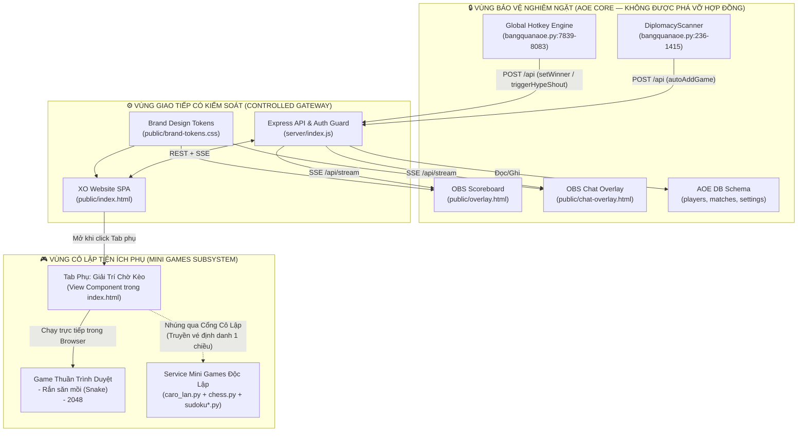

# 🔗 BẢN ĐỒ PHỤ THUỘC MODULE & RANH GIỚI CÔ LẬP (`MODULE_DEPENDENCY_MAP.md`)

> **Giai đoạn:** TASK 2 — Phân Tích Phụ Thuộc & Cô Lập Hệ Thống (Chưa can thiệp mã nguồn)  
> **Mục tiêu:** Xác định chính xác sự phụ thuộc giữa từng file/module trong cả 3 project để đảm bảo mọi nâng cấp trong tương lai không bao giờ làm hỏng **AOE Core**.

---

## 1. HIỆN TRẠNG PHỤ THUỘC GIỮA CÁC MODULE (CURRENT DEPENDENCY STATE)

### 1.1. Danh Mục Module Theo Từng Repository

#### A. Repository 1 & 2: `aoetrackerv2` (Đồng bộ với `aoe-tracker`)
1. **Nhóm Client Windows (`client/`)**:
   - [`client/bangquanaoe.py`](file:///c:/Users/APC/.gemini/antigravity/scratch/aoetrackerv2/client/bangquanaoe.py): Phụ thuộc vào thư viện nội bộ Python (`tkinter`, `ctypes`, `threading`, `tempfile`, `subprocess`), thư viện xử lý ảnh (`cv2`, `numpy`, `PIL`), tiến trình `powershell.exe` (`Windows.Media.Ocr`), file cấu hình cục bộ `%APPDATA%\bangquanaoe\settings.json`, và giao tiếp qua HTTP REST tới `server/index.js` (`/api`, `/guide/*.png`).
   - [`client/bangquanaoe.spec`](file:///c:/Users/APC/.gemini/antigravity/scratch/aoetrackerv2/client/bangquanaoe.spec): Phụ thuộc duy nhất vào `client/bangquanaoe.py` để đóng gói ra `client/dist/bangquanaoe.exe` và `TOOL_BANG_QUAN_AOE_BY_XO.exe`.
   - [`client/fb_group_live_extension/content.js`](file:///c:/Users/APC/.gemini/antigravity/scratch/aoetrackerv2/client/fb_group_live_extension/content.js): Phụ thuộc vào DOM của `facebook.com` và gọi `POST /api` (`action: "pushFacebookComment"`) trên `server/index.js`.
   - [`client/aoe_client.py`](file:///c:/Users/APC/.gemini/antigravity/scratch/aoetrackerv2/client/aoe_client.py): Module cũ (`v5.3`), **không có bất kỳ module nào phụ thuộc vào file này**.
2. **Nhóm Backend & Database (`server/`)**:
   - [`server/db.js`](file:///c:/Users/APC/.gemini/antigravity/scratch/aoetrackerv2/server/db.js): Phụ thuộc vào `pg` (Neon PostgreSQL qua `DATABASE_URL`) hoặc hệ thống file `local_db.json`. Quản lý 3 bảng `players`, `matches`, `settings`.
   - [`server/index.js`](file:///c:/Users/APC/.gemini/antigravity/scratch/aoetrackerv2/server/index.js): Phụ thuộc trực tiếp vào `server/db.js`, phục vụ các file tĩnh trong `public/` và file thực thi `TOOL_BANG_QUAN_AOE_BY_XO.exe`.
3. **Nhóm Giao Diện Web & OBS (`public/`)**:
   - [`public/brand-tokens.css`](file:///c:/Users/APC/.gemini/antigravity/scratch/aoetrackerv2/public/brand-tokens.css) & [`public/logo.svg`](file:///c:/Users/APC/.gemini/antigravity/scratch/aoetrackerv2/public/logo.svg): Được nhúng bởi cả 3 trang HTML.
   - [`public/index.html`](file:///c:/Users/APC/.gemini/antigravity/scratch/aoetrackerv2/public/index.html): Phụ thuộc vào `GET /api`, `POST /api`, `GET /api/stream` (SSE), `/download-tool` và `/guide/*.png`.
   - [`public/overlay.html`](file:///c:/Users/APC/.gemini/antigravity/scratch/aoetrackerv2/public/overlay.html) & [`public/chat-overlay.html`](file:///c:/Users/APC/.gemini/antigravity/scratch/aoetrackerv2/public/chat-overlay.html): Chỉ phụ thuộc vào `GET /api?action=getInitialData&streamer=...` và `GET /api/stream`.

#### B. Repository 3: `C:\Users\APC\caro-online`
1. **Hạt nhân máy chủ & Game Caro**:
   - [`caro_lan.py`](file:///C:/Users/APC/caro-online/caro_lan.py): Trung tâm định tuyến HTTP (`Handler.do_GET`, `Handler.do_POST`), quản lý xác thực Google OAuth / Session, quản lý toàn bộ logic Cờ Caro, Giải đấu vòng tròn, Bot AI và nhập trực tiếp các module con trong thư mục `games/`.
2. **Các Module Game Con (`games/`)**:
   - [`games/__init__.py`](file:///C:/Users/APC/caro-online/games/__init__.py): Registry độc lập, không phụ thuộc ngược vào `caro_lan.py`.
   - [`games/chess.py`](file:///C:/Users/APC/caro-online/games/chess.py) & [`games/pages.py`](file:///C:/Users/APC/caro-online/games/pages.py): Phụ thuộc vào `python-chess`, `games/__init__.py` và `games/announcements.py`.
   - [`games/sudoku.py`](file:///C:/Users/APC/caro-online/games/sudoku.py), [`games/sudoku_duel.py`](file:///C:/Users/APC/caro-online/games/sudoku_duel.py), [`games/sudoku_history.py`](file:///C:/Users/APC/caro-online/games/sudoku_history.py), [`games/sudoku_page.py`](file:///C:/Users/APC/caro-online/games/sudoku_page.py): Cụm 4 file phụ thuộc lẫn nhau (`sudoku_duel` gọi `sudoku.record_speedrun_score` và `sudoku_history.record_match_result`; `sudoku_page` render giao diện).
   - [`games/arcade_pages.py`](file:///C:/Users/APC/caro-online/games/arcade_pages.py) & [`games/arcade_scores.py`](file:///C:/Users/APC/caro-online/games/arcade_scores.py): Chứa mã nguồn độc lập của **Rắn săn mồi (`SNAKE_HTML`)** và **2048 (`GAME_2048_HTML`)** cùng bảng xếp hạng Postgres.

---

## 2. KIẾN TRÚC PHỤ THUỘC ĐỀ XUẤT & TƯỜNG LỬA CÔ LẬP (PROPOSED DEPENDENCY GRAPH)

### 2.1. Sơ Đồ Phụ Thuộc & Vùng Cấm Chạm (Dependency & Isolation Firewall)

### 2.2. Ma Trận Phân Tích Tác Động Khi Thay Đổi (Impact Analysis Matrix)

| Nếu thay đổi / nâng cấp tại Module này... | Có ảnh hưởng tới `bangquanaoe.exe` không? | Có ảnh hưởng tới 2 Link OBS không? | Có ảnh hưởng tới Bảng `players` / `matches` không? | Quy tắc an toàn bắt buộc |
| :--- | :---: | :---: | :---: | :--- |
| **1. Vá bảo mật `isAdminAuthorized` & ẩn `password` trong [`server/index.js`](file:///c:/Users/APC/.gemini/antigravity/scratch/aoetrackerv2/server/index.js)** | **Cần lưu ý** | **Không** | **Không** | `bangquanaoe.py` và `public/index.html` khi gọi các lệnh Admin phải gửi kèm `adminPassword` (hoặc token Admin hợp lệ) thay vì chỉ gửi `"isAdmin": true`. Kiểm tra tất cả các chỗ gọi Admin trong `bangquanaoe.py` (dòng `5214, 5358, 5780, 5849` — tất cả các dòng này **đã gửi sẵn `"adminPassword": self.admin_password_cached`** nên tương thích 100%!). |
| **2. Cải tiến giao diện & thêm Tab `"🎮 Giải Trí Chờ Kèo"` trong [`public/index.html`](file:///c:/Users/APC/.gemini/antigravity/scratch/aoetrackerv2/public/index.html)** | **Rất thấp (Cô lập UI)** | **Rất thấp (Cô lập UI)** | **Rất thấp (Cô lập UI)** | Giữ nguyên các hàm xử lý kèo đấu AOE, khung chat AOE và cấu hình VIP hiện có trong Vue instance. |
| **3. Tích hợp 5 Mini Games (`Caro, Sudoku, Cờ vua, Rắn, 2048`)** | **Rất thấp (Cô lập UI)** | **Rất thấp (Cô lập UI)** | **Rất thấp (Cô lập UI)** | Không chèn dữ liệu Mini Games vào phản hồi của `GET /api?action=getInitialData` để tránh làm nặng luồng đồng bộ 8s của App PC. |
| **4. Sửa lỗi trong [`C:\Users\APC\caro-online`](file:///C:/Users/APC/caro-online)** | **Rất thấp (Cô lập UI)** | **Rất thấp (Cô lập UI)** | **Rất thấp (Cô lập UI)** | Repository độc lập hoàn toàn với `aoetrackerv2`. |

---

## 3. LÝ DO LỰA CHỌN, ƯU ĐIỂM, NHƯỢC ĐIỂM & RỦI RO

- **Lý do lựa chọn**: Xác lập "vành đai an toàn" quanh cụm `DiplomacyScanner` + `OBS Overlays` + `API Contract`. Đặc biệt, phát hiện quan trọng từ việc đối chiếu mã nguồn cho thấy: trong [`client/bangquanaoe.py`](file:///c:/Users/APC/.gemini/antigravity/scratch/aoetrackerv2/client/bangquanaoe.py#L5214-L5860), mọi lệnh quản trị Admin từ App PC **đều đã gửi sẵn trường `adminPassword`** trong body JSON, nên khi vá lỗ hổng `if (data.isAdmin) return true;` trên Server, **bản `.exe` hiện tại vẫn hoạt động trơn tru mà không bị gãy chức năng Admin** (trừ trường hợp đăng nhập bằng tài khoản `XO` với mật khẩu người chơi sẽ được Server xác thực hợp lệ).
- **Ưu điểm**: Kiểm soát chính xác phạm vi ảnh hưởng của từng dòng code trước khi bắt tay vào lập trình.
- **Nhược điểm**: Cần tuân thủ kỷ luật không trộn lẫn state của Mini Games vào state `matches` của AOE.
- **Rủi ro**: Nếu lập trình viên vô tình sửa tên trường trong `getInitialDataPayload()` của `server/index.js`, cả App PC và OBS sẽ bị ảnh hưởng. Do đó mọi thay đổi ở `server/index.js` phải tuân theo tài liệu [`API_CONTRACT.md`](file:///c:/Users/APC\.gemini/antigravity/scratch/aoetrackerv2/API_CONTRACT.md).

---

## 4. CÁC MODULE BỊ ẢNH HƯỞNG & PHƯƠNG ÁN ROLLBACK

- **Các module nằm trong danh sách được phép chỉnh sửa khi sang giai đoạn Thực thi (Task 3)**:
  1. [`server/index.js`](file:///c:/Users/APC/.gemini/antigravity/scratch/aoetrackerv2/server/index.js) (Chỉ vá bảo mật và thêm route tách biệt cho Mini Games nếu cần).
  2. [`public/index.html`](file:///c:/Users/APC/.gemini/antigravity/scratch/aoetrackerv2/public/index.html) (Nâng cấp giao diện trung tâm sản phẩm AOE, vá lỗi Ghim/FB Bridge, thêm tab phụ `🎮 Giải Trí Chờ Kèo`).
  3. [`client/bangquanaoe.py`](file:///c:/Users/APC/.gemini/antigravity/scratch/aoetrackerv2/client/bangquanaoe.py) & [`client/fb_group_live_extension/`](file:///c:/Users/APC/.gemini/antigravity/scratch/aoetrackerv2/client/fb_group_live_extension/) (Chỉ sửa lỗi thiếu `import datetime`, giới hạn 4 trận ở sảnh, và URL mặc định của extension).
  4. [`C:\Users\APC\caro-online\`](file:///C:/Users/APC/caro-online/) (Vá lỗi `/reset`, XSS, đá chặn Caro, khóa AI/phòng chờ Cờ vua).
- **Các module BẤT KHẢ XÂM PHẠM (Không chỉnh sửa)**:
  - Class `DiplomacyScanner` (`bangquanaoe.py:236–1415`), [`public/overlay.html`](file:///c:/Users/APC/.gemini/antigravity/scratch/aoetrackerv2/public/overlay.html), [`public/chat-overlay.html`](file:///c:/Users/APC/.gemini/antigravity/scratch/aoetrackerv2/public/chat-overlay.html), và cấu trúc bảng trong [`server/db.js`](file:///c:/Users/APC/.gemini/antigravity/scratch/aoetrackerv2/server/db.js).
- **Phương án Rollback**:
  - Khôi phục độc lập từng file theo nhánh Git của từng repository mà không gây hiệu ứng dây chuyền giữa `caro-online` và `aoetrackerv2`.
