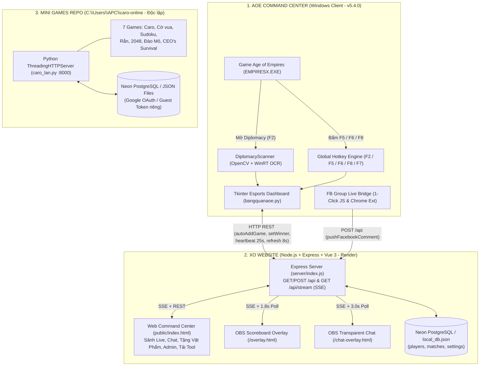
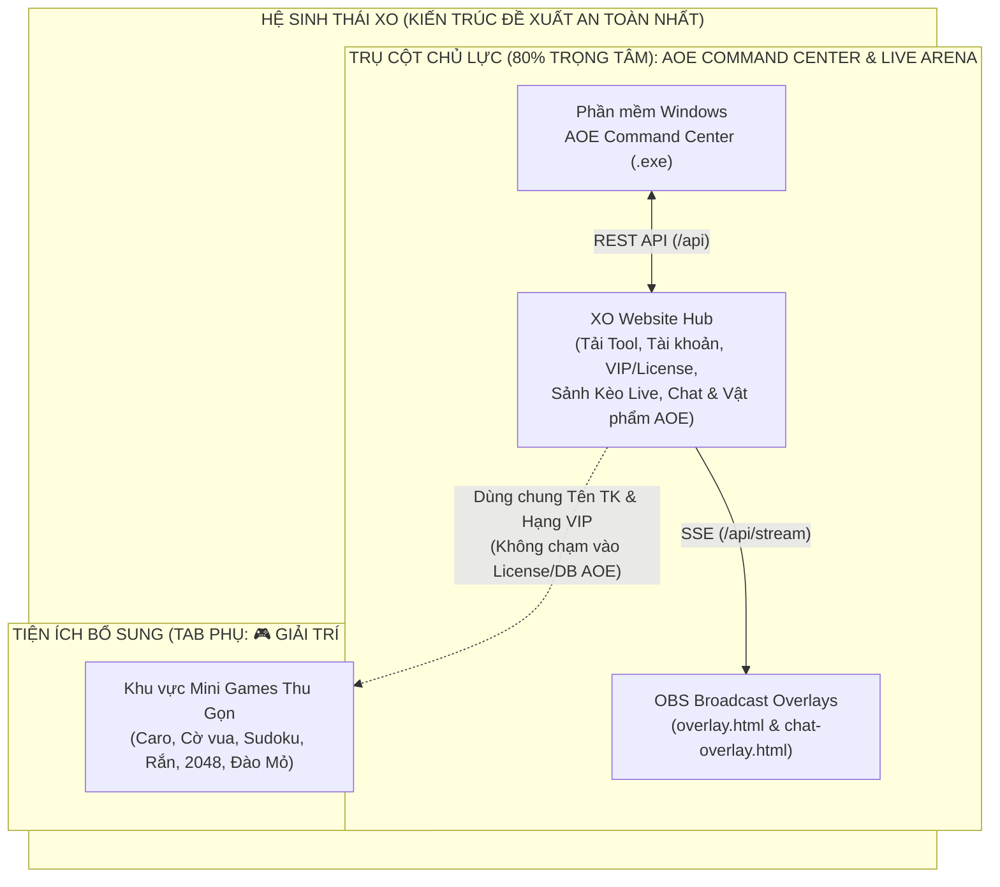

# 🛡️⚔️ XO ECOSYSTEM — MASTER PROJECT AUDIT (`PROJECT_AUDIT.md`)

> **Ngày khảo sát:** 06/11/2026  
> **Phạm vi khảo sát:** Độc lập 100% mã nguồn của 3 Project (`AOE Command Center`, `XO Website`, `Mini Games - caro-online`)  
> **Trạng thái thực thi:** **CHỈ ĐỌC & PHÂN TÍCH (READ-ONLY AUDIT)** — Tuyệt đối chưa chỉnh sửa bất kỳ dòng code, cấu trúc thư mục, database, API hay thực hiện Git commit/push nào.

---

## 1. TỔNG QUAN 3 PROJECT & HIỆN TRẠNG THƯƠNG HIỆU

### 1.1. Bảng Tổng Quan 3 Project Hiện Tại

| Thuộc tính | Project 1: AOE Command Center | Project 2: XO Website | Project 3: Mini Games (`caro-online`) |
| :--- | :--- | :--- | :--- |
| **Đường dẫn gốc** | [`c:\Users\APC\.gemini\antigravity\scratch\aoetrackerv2\client\`](file:///c:/Users/APC/.gemini/antigravity/scratch/aoetrackerv2/client/) *(Đồng bộ 100% với `aoe-tracker\client`)* | [`c:\Users\APC\.gemini\antigravity\scratch\aoetrackerv2\`](file:///c:/Users/APC/.gemini/antigravity/scratch/aoetrackerv2/) (`server/` & `public/`) | [`C:\Users\APC\caro-online\`](file:///C:/Users/APC/caro-online/) |
| **Vai trò trong Hệ sinh thái** | **Sản phẩm cốt lõi (Flagship Core Product)** — Phần mềm Windows cho Streamer/Game thủ AOE 1. | **Trung tâm điều phối & Thương mại (Product & License Hub)** — Quản lý tài khoản, VIP, tải phần mềm, Sảnh Live, OBS Overlays. | **Tiện ích giải trí bổ sung (Secondary Utility)** — Bộ trò chơi giải trí trên trình duyệt. |
| **Tên thương hiệu hiện tại** | **TOOL BẢNG QUÂN AOE BY XO (`v5.4.0`)** | **AOE BY XO (`v5.4.0`)** | **XO Games** (`XO Neon`) |
| **Ngôn ngữ & Nền tảng** | Python 3.14 (`tkinter`, `opencv-python`, `numpy`, `Pillow`, WinRT OCR, `ctypes` Win32 Hooks) đóng gói `.exe` (`PyInstaller`). | Backend: Node.js + Express + SSE (`/api/stream`). Frontend: Vue 3 (CDN) + Tailwind CSS + Chart.js. | Backend: Python `ThreadingHTTPServer` ([`caro_lan.py`](file:///C:/Users/APC/caro-online/caro_lan.py)). Frontend: Vanilla JS + Canvas 2D + WebRTC + WebAudio. |
| **Cơ sở dữ liệu** | Cấu hình cục bộ `%APPDATA%\bangquanaoe\settings.json`; đồng bộ qua REST API với XO Website. | **Neon PostgreSQL** (`players`, `matches`, `settings`) + tự động fallback về `local_db.json`. | **Neon PostgreSQL** (bảng riêng cho Caro, Giải đấu, Tài khoản Google, Sudoku, 2048, Snake, Đào Mỏ) + fallback file `.json` cục bộ. |
| **Quy mô mã nguồn** | [`client/bangquanaoe.py`](file:///c:/Users/APC/.gemini/antigravity/scratch/aoetrackerv2/client/bangquanaoe.py) (8.173 dòng), [`client/aoe_client.py`](file:///c:/Users/APC/.gemini/antigravity/scratch/aoetrackerv2/client/aoe_client.py) (4.523 dòng - bản cũ), Chrome Extension (2 files). | [`server/index.js`](file:///c:/Users/APC/.gemini/antigravity/scratch/aoetrackerv2/server/index.js) (2.487 dòng), [`server/db.js`](file:///c:/Users/APC/.gemini/antigravity/scratch/aoetrackerv2/server/db.js) (474 dòng), [`public/index.html`](file:///c:/Users/APC/.gemini/antigravity/scratch/aoetrackerv2/public/index.html) (3.527 dòng), [`overlay.html`](file:///c:/Users/APC/.gemini/antigravity/scratch/aoetrackerv2/public/overlay.html) (790 dòng), [`chat-overlay.html`](file:///c:/Users/APC/.gemini/antigravity/scratch/aoetrackerv2/public/chat-overlay.html) (534 dòng). | [`caro_lan.py`](file:///C:/Users/APC/caro-online/caro_lan.py) (6.250+ dòng) + 14 modules trong [`games/`](file:///C:/Users/APC/caro-online/games/) (~390 KB code + ~17 MB âm thanh/ảnh). |

### 1.2. Phát Hiện Quan Trọng Về Danh Mục Mini Games Thực Tế
Mặc dù mô tả ban đầu chỉ nhắc đến 4 trò chơi (Caro, Sudoku, Cờ vua, Rắn), khảo sát trực tiếp registry [`C:\Users\APC\caro-online\games\__init__.py`](file:///C:/Users/APC/caro-online/games/__init__.py#L41-L90) và source code cho thấy repo thực tế đang triển khai **7 trò chơi đầy đủ**:
1. **`caro` — Cờ Caro** (`/caro`): Bàn 25×25, PvP/PvE 5 cấp độ, Địa hình (Obstacle), Giải đấu vòng tròn, Bot Duel tự động, Voice Chat WebRTC, Elo & Playstyle Radar.
2. **`chess` — Cờ vua** (`/chess`): Chuẩn luật FIDE (`python-chess`), đồng hồ 10+5, PvP & đấu máy 3 cấp độ.
3. **`sudoku` — Sudoku** (`/sudoku`): Solo 5 độ khó, Thử thách hằng ngày (Daily Challenge), Bảng xếp hạng Speedrun, **Đấu Tay Đôi 1v1** và **Đua Tốc Độ 2–8 người** ([`sudoku_duel.py`](file:///C:/Users/APC/caro-online/games/sudoku_duel.py)).
4. **`snake` — Rắn săn mồi** (`/snake`): Canvas 20×20 nội suy 60fps, 6 chủ đề giao diện, bảng xếp hạng tuần/mọi thời đại.
5. **`2048` — 2048** (`/2048`): Lưới 4×4, hỗ trợ hoàn tác (`Ctrl+Z`), âm thanh WebAudio, bảng xếp hạng ngày/tuần/tháng.
6. **`gold-miner` — Đào Mỏ Kiểu OEV** (`/gold-miner`): Game arcade nhiều màn chơi ([`gold_miner.js`](file:///C:/Users/APC/caro-online/games/gold_miner.js)), đồ họa & âm thanh riêng, bảng xếp hạng lưu Postgres + `gold_scores.json`.
7. **`ceo-survival` — CEO's Survival** (`/ceo-survival`, `status="beta"`): Game sinh tồn văn phòng 5 vòng chơi kiểu Squid Game (Solo với 11 Bot hoặc Multiplayer phòng 4 ký tự), kỹ năng đâm sau lưng, thuyết minh giọng đọc tiếng Việt.

### 1.3. Hiện Trạng Nhận Diện Thương Hiệu (Brand Identity Audit)
- **AOE Command Center & XO Website**: Đã được chuẩn hóa đồng bộ theo bộ nhận diện **AOE BY XO (`Imperial Tactical Wood-Gold Esports`)** quy định tại [`docs/brand-guidelines.md`](file:///c:/Users/APC/.gemini/antigravity/scratch/aoetrackerv2/docs/brand-guidelines.md) và [`public/brand-tokens.css`](file:///c:/Users/APC/.gemini/antigravity/scratch/aoetrackerv2/public/brand-tokens.css):
  - **Logo chính**: [`public/logo.svg`](file:///c:/Users/APC/.gemini/antigravity/scratch/aoetrackerv2/public/logo.svg) (Khiên Chiến Thuật Obsidian `#0F172A`, Song Kiếm Chéo Vàng `#ECA133`, Vương Miện 3 Đỉnh & chữ `"XO"` ở tâm khiên). Trên App PC, logo này được vẽ lại bằng Vector Canvas (`_create_brand_crest_canvas` tại [`client/bangquanaoe.py`](file:///c:/Users/APC/.gemini/antigravity/scratch/aoetrackerv2/client/bangquanaoe.py#L2102-L2133)).
  - **Bảng màu & Font**: Nền Đá Đen Obsidian (`#060913` / `#111622`), Vàng Hoàng Gia (`#ECA133`), Đỏ Team (`#F43F5E`), Xanh Team (`#3B82F6`), Cyan Chiến Thuật (`#38BDF8`); Font `Chakra Petch` + `Inter` + `JetBrains Mono`.
- **Mini Games (`caro-online`)**: Đang dùng thương hiệu **XO Games** với tông màu **Tím Neon (`#7C3AED` / `#A855F7`)** trên nền tối `#090912`.
- **Đánh giá định hướng thương hiệu mẹ XO**:
  - Thương hiệu gốc `"XO"` và biểu tượng Khiên Vương Miện `"XO"` đã hiện diện xuyên suốt. Việc giữ **AOE Command Center (`AOE BY XO`)** làm thương hiệu & sản phẩm chủ lực ở vị trí trung tâm, đồng thời quy hoạch lại màu sắc của khu vực tiện ích giải trí phụ trợ theo tông **Obsidian – Gold – Cyan** của hệ sinh thái XO là hoàn toàn tự nhiên, không gây xáo trộn nhận diện đối với cộng đồng người dùng AOE hiện tại.

---

## 2. CÔNG NGHỆ & KIẾN TRÚC HIỆN TẠI

### 2.1. Project 1 — AOE Command Center (`client/`)

#### A. Ngôn ngữ, Thư viện & Công nghệ
- **Ngôn ngữ**: Python 3 (đóng gói với Python 3.14 trong `.venv`).
- **Giao diện (GUI)**: `tkinter` & `tkinter.ttk` (`clam` theme tùy biến thành giao diện tối `#0b0e14` / `#121721` viền vàng `#f59e0b`).
- **Thị giác máy tính (Computer Vision) & OCR**:
  - `opencv-python>=4.8.0` (`cv2`): Bộ lọc cạnh Sobel (`cv2.Sobel`), chuyển đổi không gian màu HSV, biểu đồ tần suất Hue 180-bin (`cv2.calcHist`), nội suy đa tỷ lệ (`INTER_LANCZOS4`, `INTER_CUBIC`, `INTER_AREA`) và so khớp mẫu tương quan chéo chuẩn hóa (ZNCC `cv2.filter2D`).
  - `numpy>=1.24.0` (`np`): Tính mảng tích phân 2 chiều (`np.cumsum`) để tìm khung hộp thoại Diplomacy ở chế độ cửa sổ lệch tâm, xử lý ngưỡng phân vị (percentile thresholding).
  - `pillow>=10.0.0` (`PIL.ImageGrab`, `ImageDraw`, `ImageFont`): Chụp toàn bộ đa màn hình (`ImageGrab.grab(all_screens=True)`) và dựng bộ mẫu ký tự 2D tự động từ font hệ thống `C:/Windows/Fonts/arialbd.ttf` (`build_text_templates`, dòng `195–230`).
  - **Windows Native WinRT OCR (`Windows.Media.Ocr.OcrEngine`)**: Gọi qua tiến trình con `powershell -NoProfile -Command` ẩn cửa sổ (`DiplomacyScanner.run_windows_ocr_batch` tại [`client/bangquanaoe.py`](file:///c:/Users/APC/.gemini/antigravity/scratch/aoetrackerv2/client/bangquanaoe.py#L617-L693)), ghép toàn bộ các ô Tên & Quân (4 mức phơi sáng/ô) vào một ảnh lưới duy nhất để đọc tọa độ chữ tốc độ cao.
- **Tích hợp Hệ điều hành Windows (`ctypes` Win32 API)**:
  - **Nhận diện độ phân giải cao (Per-Monitor DPI Awareness)**: `shcore.SetProcessDpiAwareness(2)` (dòng `23–31`) giúp chụp màn hình 2K/4K (Scale 125%–150%) không bị lệch tọa độ.
  - **Tự động nâng quyền Administrator (UAC Elevation)**: `shell32.IsUserAnAdmin()` và `shell32.ShellExecuteW(None, "runas", ...)` (dòng `47–83`) để bắt phím tắt xuyên qua cửa sổ game `EMPIRESX.EXE`.
  - **Engine Bắt Phím Tắt & Chuột 3 Tầng (`_monitor_diplomacy_events`, dòng `7839–8083`)**:
    1. Tầng 1: Hook bàn phím mức nhân `user32.SetWindowsHookExW(WH_KEYBOARD_LL=13, ...)`.
    2. Tầng 2: Quét trạng thái phím & chuột mỗi `20ms` bằng `user32.GetAsyncKeyState` + `GetCursorPos` + `GetForegroundWindow` (phát hiện thao tác click chuột trái vào nút `Diplomacy` trên thanh menu trên cùng của game AOE: `x: 65%..96%`, `y: 0%..8.5%`).
    3. Tầng 3: Đăng ký phím nóng hệ thống `user32.RegisterHotKey` (`WM_HOTKEY=0x0312`).
  - **Chống bóng mờ giao diện (Anti-Ghosting Repaint)**: `user32.RedrawWindow(hwnd, None, None, 0x0185)` (dòng `2089–2100`).
- **Âm báo**: `winsound.Beep(freq, duration)` báo hiệu khi bấm `F5` (880Hz), `F6` (1046Hz), `F8` (987Hz → 1318Hz), hoặc báo lỗi khi chưa quét quân (330Hz).
- **Mạng**: `requests>=2.31.0` chạy bất đồng bộ trong các luồng `threading.Thread(..., daemon=True)`.
- **Đóng gói**: `pyinstaller>=6.0.0` thông qua [`client/bangquanaoe.spec`](file:///c:/Users/APC/.gemini/antigravity/scratch/aoetrackerv2/client/bangquanaoe.spec) (`onefile`, `console=False`, `uac_admin=True`).

#### B. Kiến trúc Module trong `client/`
1. **[`client/bangquanaoe.py`](file:///c:/Users/APC/.gemini/antigravity/scratch/aoetrackerv2/client/bangquanaoe.py) (8.173 dòng — File chạy chính thức `v5.4.0`)**:
   - **Phần 1 (`Dòng 1–231`)**: Khởi tạo DPI, nâng quyền Admin, hằng số 16 loại quân (`CIV_LIST`), bảng màu cờ HSV (`AOE_RIBBON_HSV`), từ điển ~240 tên tướng AI theo từng loại quân (`CIV_AI_NAMES`) và hàm dựng mẫu chữ 2D (`build_text_templates`).
   - **Phần 2 (`Dòng 236–1415`) — Class [`DiplomacyScanner`](file:///c:/Users/APC/.gemini/antigravity/scratch/aoetrackerv2/client/bangquanaoe.py#L236-L1415)**: Pipeline thị giác máy tính độc lập (tìm khung hộp thoại `find_diplomacy_box`, xác thực cấu trúc `verify_is_diplomacy_dialog`, trích xuất màu cờ `extract_ribbon_hsv` & `assign_player_colors`, gọi WinRT OCR `run_windows_ocr_batch`, khớp tên quân `match_civ_for_row`, làm sạch & khớp tên người chơi `clean_and_match_player_name`, và hàm điều phối `parse_diplomacy_from_image`).
   - **Phần 3 (`Dòng 1420–1493`)**: Quản lý đọc/ghi file cấu hình `%APPDATA%\bangquanaoe\settings.json` và danh mục vật phẩm `AOE_GIFT_ITEMS`.
   - **Phần 4 (`Dòng 1495–8173`) — Class [`AOETrackerApp`](file:///c:/Users/APC/.gemini/antigravity/scratch/aoetrackerv2/client/bangquanaoe.py#L1495-L8151)**: Quản lý toàn bộ giao diện Tkinter (Login Gate, Bố cục 3 cột Dashboard, Tab cài đặt VIP OBS, các cửa sổ Modal Hồ sơ / Admin / Hướng dẫn OBS / Cầu nối FB Group Live) và 2 luồng chạy ngầm (`_monitor_diplomacy_events` & `_background_worker`).
2. **[`client/aoe_client.py`](file:///c:/Users/APC/.gemini/antigravity/scratch/aoetrackerv2/client/aoe_client.py) (4.523 dòng — File cũ `v5.3` không còn sử dụng)**:
   - Đây là bản snapshot cũ từ thời điểm `v5.3`, không được import hay gọi bởi bất kỳ file nào trong hệ thống.
3. **[`client/fb_group_live_extension/`](file:///c:/Users/APC/.gemini/antigravity/scratch/aoetrackerv2/client/fb_group_live_extension/)**:
   - Tiện ích trình duyệt Chrome/Edge/Cốc Cốc (Manifest V3) gồm [`manifest.json`](file:///c:/Users/APC/.gemini/antigravity/scratch/aoetrackerv2/client/fb_group_live_extension/manifest.json) và [`content.js`](file:///c:/Users/APC/.gemini/antigravity/scratch/aoetrackerv2/client/fb_group_live_extension/content.js) tự động quét bình luận trên luồng livestream Facebook Group đẩy về Server.

---

### 2.2. Project 2 — XO Website (`server/` & `public/`)

#### A. Backend & Database ([`server/index.js`](file:///c:/Users/APC/.gemini/antigravity/scratch/aoetrackerv2/server/index.js), [`server/db.js`](file:///c:/Users/APC/.gemini/antigravity/scratch/aoetrackerv2/server/db.js))
- **Runtime**: Node.js (`>=18.0.0`) + Express `^4.19.2` + `cors` + `dotenv` + `pg` (`^8.12.0`).
- **Truyền tải thời gian thực (Realtime Push)**: **Server-Sent Events (SSE)** tại endpoint `GET /api/stream` (dòng `892–914`), duy trì tập kết nối `sseClients` và gửi gói giữ kết nối (`: keep-alive`) mỗi 25 giây.
- **Cơ chế lưu trữ kép (Dual-Mode Persistence trong [`server/db.js`](file:///c:/Users/APC/.gemini/antigravity/scratch/aoetrackerv2/server/db.js))**:
  - Khi biến môi trường `DATABASE_URL` hợp lệ: Kết nối **Neon PostgreSQL** và tự động khởi tạo 3 bảng:
    1. `players`: `name` (PK), `password`, `tier`, `is_active`, `activated_at`, `expires_at`, `note`, `overlay_config` (JSONB), `social_data` (JSONB lưu `friends`, `starsReceived`, `starsBalance`, `starHistory`, `vipHistory`, `lastSeenAt`), `created_at`.
    2. `matches`: `id` (PK), `streamer_name`, `status`, `created_at`, `last_heartbeat`, `data` (JSONB lưu toàn bộ thông tin kèo, danh sách `games[]`, `chatMessages[]`, `pinnedChat`, `lastHypeShout`), `updated_at`.
    3. `settings`: `key` (PK), `value` (JSONB lưu `showCivStats` và `appRelease`).
  - Khi chưa cấu hình `DATABASE_URL` hoặc mất kết nối Postgres: Tự động chuyển sang đọc/ghi file cục bộ `local_db.json` mà không làm sập server.

#### B. Frontend & OBS Overlays ([`public/`](file:///c:/Users/APC/.gemini/antigravity/scratch/aoetrackerv2/public/))
- **Công nghệ**: Vue 3 Global Build (`vue.global.js`) + Tailwind CSS CDN + [`public/brand-tokens.css`](file:///c:/Users/APC/.gemini/antigravity/scratch/aoetrackerv2/public/brand-tokens.css) + FontAwesome 6.5.1 + Chart.js.
- **Ba ứng dụng giao diện độc lập**:
  1. [`public/index.html`](file:///c:/Users/APC/.gemini/antigravity/scratch/aoetrackerv2/public/index.html) (3.527 dòng): Trang chủ Web Command Center, Sảnh Kèo Đấu Đang Live, Chi tiết kèo & Chấm tỉ số, Thống kê biểu đồ Quân (Cung/Chém), Danh sách Bạn bè, Khung Chat Live & Tặng Vật Phẩm Đế Chế, Hồ sơ cá nhân, Bảng Quản trị Admin và Hướng dẫn OBS có ảnh minh họa.
  2. [`public/overlay.html`](file:///c:/Users/APC/.gemini/antigravity/scratch/aoetrackerv2/public/overlay.html) (790 dòng): Nguồn trình duyệt OBS 1 (`550x210` hoặc `750x210` khi bật Đánh theo C) hiển thị Bảng Quân 2 đội, Màu cờ, Tỉ số, Chữ chạy Marquee, Bảng phụ C-Mode, Bảng Vinh Danh Vật Phẩm Hoàng Gia và Hiệu ứng ăn mừng `F8` (`"Tay đâu, tayyyy đâuuuuu"`).
  3. [`public/chat-overlay.html`](file:///c:/Users/APC/.gemini/antigravity/scratch/aoetrackerv2/public/chat-overlay.html) (534 dòng): Nguồn trình duyệt OBS 2 (`380x450`) hiển thị Khung Chat nền trong suốt 100%, tự động ẩn hoàn toàn sau 10 giây không có tin nhắn mới và tự động hiện lại khi có bình luận hoặc quà tặng mới.

---

### 2.3. Project 3 — Mini Games (`C:\Users\APC\caro-online`)

- **Kiến trúc Server**: Ứng dụng web Python đơn khối sử dụng `ThreadingHTTPServer` + `BaseHTTPRequestHandler` trong [`caro_lan.py`](file:///C:/Users/APC/caro-online/caro_lan.py#L3844-L6245).
- **Hệ thống Module Game ([`C:\Users\APC\caro-online\games\`](file:///C:/Users/APC/caro-online/games/))**:
  - [`games/__init__.py`](file:///C:/Users/APC/caro-online/games/__init__.py): Registry đăng ký metadata cho 7 trò chơi (`caro`, `chess`, `sudoku`, `2048`, `gold-miner`, `snake`, `ceo-survival`).
  - [`games/pages.py`](file:///C:/Users/APC/caro-online/games/pages.py): Render trang Sảnh chọn game (`/games` hoặc `/`) và toàn bộ giao diện Cờ vua (`/chess`).
  - [`games/chess.py`](file:///C:/Users/APC/caro-online/games/chess.py): Quản lý phòng chơi, đồng hồ 10+5, AI 3 cấp độ và luật cờ vua FIDE qua thư viện `python-chess`.
  - [`games/sudoku.py`](file:///C:/Users/APC/caro-online/games/sudoku.py), [`games/sudoku_duel.py`](file:///C:/Users/APC/caro-online/games/sudoku_duel.py), [`games/sudoku_history.py`](file:///C:/Users/APC/caro-online/games/sudoku_history.py), [`games/sudoku_page.py`](file:///C:/Users/APC/caro-online/games/sudoku_page.py): Bộ giải & sinh bảng Sudoku duy nhất một nghiệm, thử thách hằng ngày, đấu 1v1 / đua nhiều người (2–8 người), danh hiệu và giao diện `/sudoku`.
  - [`games/arcade_pages.py`](file:///C:/Users/APC/caro-online/games/arcade_pages.py), [`games/arcade_scores.py`](file:///C:/Users/APC/caro-online/games/arcade_scores.py), [`games/gold_miner.js`](file:///C:/Users/APC/caro-online/games/gold_miner.js): Giao diện HTML/Canvas và API điểm số cho 3 game Arcade: **2048** (`/2048`), **Rắn săn mồi** (`/snake`), và **Đào Mỏ Kiểu OEV** (`/gold-miner`).
  - [`games/ceo_survival.py`](file:///C:/Users/APC/caro-online/games/ceo_survival.py), [`games/ceo_survival.html`](file:///C:/Users/APC/caro-online/games/ceo_survival.html), [`games/ceo_survival.js`](file:///C:/Users/APC/caro-online/games/ceo_survival.js): Backend state machine và Frontend 5 vòng chơi của **CEO's Survival** (`/ceo-survival`).
  - [`games/voice.py`](file:///C:/Users/APC/caro-online/games/voice.py) & [`games/voice.js`](file:///C:/Users/APC/caro-online/games/voice.js): Signaling server và client WebRTC Mesh cho tính năng đàm thoại giọng nói trực tiếp trong phòng chơi.
  - [`games/announcements.py`](file:///C:/Users/APC/caro-online/games/announcements.py): Widget kênh thông báo/chat tổng nhúng trên các trang game.

---

## 3. KHẢO SÁT CHI TIẾT PROJECT 1: AOE COMMAND CENTER

### 3.1. Danh Sách Đầy Đủ Các Chức Năng Hiện Có
1. **Khởi động chuẩn DPI & Tự động nâng quyền Administrator (`Dòng 23–83`)**: Đảm bảo chụp màn hình chuẩn xác trên màn hình độ phân giải cao và bắt được phím tắt khi cửa sổ game Đế Chế đang chiếm quyền điều khiển.
2. **Kiểm tra phiên bản & Tự động nhắc cập nhật (`_startup_version_check`, `Dòng 4586–4671`)**: So sánh `APP_VERSION_NUMBER = "5.4.0"` với `appRelease.latestVersion` trên Server; hỗ trợ chế độ bắt buộc cập nhật (`forceUpdate`) đối với người dùng thường.
3. **Cổng Đăng Nhập Khởi Động (`Login Gate`, `Dòng 2135–2342`, `4680–4821`)**: Tự động điền thông tin đã lưu, kiểm tra hạn dùng tài khoản, tự động kết thúc các kèo `LIVE` bị treo từ phiên trước ngay khi đăng nhập mới.
4. **Bộ Quét Bảng Quân Tự Động Bằng Thị Giác Máy Tính & OCR (`DiplomacyScanner`, `Dòng 236–1415`)**:
   - Tự động phát hiện khung hộp thoại `Diplomacy` ở mọi độ phân giải (`800x600` đến `4K`), cả chế độ toàn màn hình lẫn cửa sổ lệch tâm.
   - Kiểm tra cấu trúc hộp thoại nghiêm ngặt (`verify_is_diplomacy_dialog`, dòng `449–524`): tiêu đề `DIPLOMACY`, nút `OK`, `CANCEL`, `CLEAR TRIBUTES`, tiêu đề cột `Name`, `Civilization`, `Ally`.
   - Nhận diện 8 màu cờ người chơi bằng phân tích dải màu HSV (`extract_ribbon_hsv` & `assign_player_colors`, dòng `534–614`).
   - Kết hợp WinRT OCR đa mức phơi sáng và so khớp mẫu 2D ZNCC để nhận diện chính xác 16 loại quân AOE (`match_civ_for_row`, dòng `695–794`) và tên người chơi / ~240 tên tướng AI (`clean_and_match_player_name`, dòng `850–1089`).
   - Tự động xác định dòng của chủ máy dựa vào độ lệch viền nút radio (`radio_diff`, dòng `1285–1298`) để chia chuẩn xác 2 phe **Team Đỏ** (Đồng minh) và **Team Xanh** (Đối thủ).
5. **Tự Động Căn Chỉnh Đội Hình Xuyên Suốt Kèo Đấu (`_align_parsed_with_current_match`, `Dòng 7216–7278`)**: Giữ nguyên thứ tự người chơi ở Team Đỏ / Team Xanh ngay cả khi người chơi đổi vị trí slot trong phòng chờ giữa các trận; chặn tạo trùng trận nếu bộ quân không đổi.
6. **Engine Phím Tắt Toàn Cục 3 Tầng (`_monitor_diplomacy_events`, `Dòng 7839–8083`)**:
   - Bấm `F2`, `Alt+D`, hoặc click chuột trái vào nút `Diplomacy` trên thanh menu game sẽ mở cửa sổ quét cưỡng bức `2.6 giây`.
   - `F5`: Cộng `+1` trận thắng cho Team Đỏ (kèm âm báo `880Hz`).
   - `F6`: Cộng `+1` trận thắng cho Team Xanh (kèm âm báo `1046Hz`).
   - `F8`: Kích hoạt hiệu ứng ăn mừng `"Tay đâu, tayyyy đâuuuuu"` trên cả bảng tỉ số App PC và OBS Overlay.
   - `F3` (Test ảnh mẫu từ máy tính) và `F7` (Kết thúc kèo đấu hiện tại).
7. **Bảng Tỉ Số Trung Tâm (Hero Live Scoreboard, `Dòng 3009–3287`, `6800–6915`)**: Hiển thị khiên vector Đỏ/Xanh, đội hình & loại quân, tỉ số trực tiếp, lịch sử thắng từng ván (`V1`, `V2`...), kết quả Séc đấu (C-Mode), nút `+1 Đỏ`, `+1 Xanh`, `↩️ Hoàn tác (-1)` và `🗑️ Kết thúc kèo [F7]`.
8. **Sảnh Các Trận Đấu Đang Live & Chế Độ Theo Dõi (`Dòng 2843–2950`, `6221–6417`)**: Tìm kiếm, lọc trận (`Tất cả`, `Đang LIVE`, `Đã kết thúc`), bấm `👁️ Xem trận` để theo dõi tỉ số/quân và trò chuyện tại sảnh của Streamer khác, hoặc tặng nhanh Voi Điên (`🐘 22`).
9. **Hệ Thống Bạn Bè & Trạng Thái Online/LIVE (`Dòng 2771–2839`, `6601–6633`)**: Kết bạn, hủy kết bạn, xem trạng thái đang phát sóng hoặc đang trực tuyến của bạn bè.
10. **Khung Chat Đứng, Tặng Vật Phẩm Đế Chế & Bảng Vinh Danh (`Dòng 3371–3840`, `6418–6752`)**:
    - Hiển thị bình luận thời gian thực, Bảng Vinh Danh Hoàng Gia (`👑 VINH DANH`), tin nhắn ghim (`📌 Ghim`), lọc chat theo danh mục (`Tất cả`, `💬 Chat`, `🎁 Quà`, `⚙️ Hệ thống`), tìm kiếm nội dung chat và gộp tin nhắn lặp (`_condense_spam_text`).
    - Ngăn kéo 6 vật phẩm Đế Chế (`🍖 200 Thực - 5⭐`, `🪵 500 Gỗ - 10⭐`, `🥩 1000 Thực - 15⭐`, `🐘 Con Voi - 22⭐`, `🏹 Song Mã - 50⭐`, `⚡ Phù Thủy Sét - 100⭐`) + 4 mức tặng Sao nhanh (`+1`, `+10`, `+50`, `+100`).
11. **Tab Tùy Chỉnh Cài Đặt VIP OBS (`Dòng 3844–4064`, `5968–6033`)**: Cấu hình điểm chạm (`Chạm X`), bật/tắt ngày tháng, chế độ chữ chạy (`Marquee`), chế độ Đánh theo C (`Séc đấu`), bật/tắt Khung Ảo căn OBS (`showIdlePreview`) và copy nhanh 2 đường link OBS.
12. **Cửa Sổ Hồ Sơ Tài Khoản & Đổi Mật Khẩu (`open_my_profile_window`, `Dòng 4823–5097`)**: Xem hạng VIP, ngày kích hoạt, ngày hết hạn, số dư Sao, lịch sử nhận/tặng Sao, lịch sử gia hạn VIP và đổi mật khẩu cá nhân (yêu cầu `>= 8` ký tự, nhập 2 lần).
13. **Trung Tâm Quản Trị Admin XO (`open_admin_manager_window`, `Dòng 5099–5946`)**: Quản lý phát hành phiên bản mới (`App Release`), dọn dẹp lịch sử trận đấu theo 6 chế độ, thêm/sửa/xóa User, nạp Sao (`+⭐`), gia hạn VIP nhanh (`+30 ngày`, `+1 năm`, `+N ngày`, `Vĩnh viễn`), khóa/mở khóa tài khoản.
14. **Cầu Nối Bình Luận Facebook Group Live (`Dòng 6932–7211` & `fb_group_live_extension/`)**: Tạo mã Javascript 1-Click dán vào Console trình duyệt (kèm nút bắn thử comment giả lập) hoặc dùng Chrome Extension để tự động đẩy bình luận từ luồng Live Facebook Group lên OBS.
15. **Cửa Sổ Hướng Dẫn Gắn OBS Trực Quan (`show_obs_guide_window`, `Dòng 4282–4565`)**: Tải bất đồng bộ 6 ảnh minh họa từ `/guide/*.png` kèm hướng dẫn từng bước.
16. **Tự Động Kết Thúc Kèo Khi Đóng App & Gửi Heartbeat (`Dòng 1552–1554`, `7769–7837`, `8135–8145`)**: Gửi tín hiệu `heartbeat` mỗi `25 giây` và tự động gọi `finishMatch` (`reason: "APP_CLOSED"`) khi đóng cửa sổ hoặc thoát tiến trình (`atexit`).

### 3.2. Đánh Giá Trạng Thái Hoạt Động & Các Lỗi Phát Hiện Trong `client/`

| Mã lỗi | File & Dòng | Mức độ | Mô tả chi tiết vấn đề | Hướng xử lý đề xuất |
| :--- | :--- | :---: | :--- | :--- |
| **ACC-01** | [`client/bangquanaoe.py`](file:///c:/Users/APC/.gemini/antigravity/scratch/aoetrackerv2/client/bangquanaoe.py#L6502) | **Medium** | **Thiếu `from datetime import datetime` gây lỗi ngầm khi hiển thị giờ Chat**: Dòng `6502` gọi `datetime.fromisoformat(...)` nhưng module `datetime` chưa được import ở đầu file (`dòng 1–20`). Lỗi `NameError` bị khối `except Exception:` bắt lại ở dòng `6504` và cắt chuỗi `ts_raw[11:16]`, khiến toàn bộ giờ chat trên App PC hiển thị theo **giờ UTC** (lệch -7 tiếng so với giờ Việt Nam). | Bổ sung `from datetime import datetime` vào đầu file [`client/bangquanaoe.py`](file:///c:/Users/APC/.gemini/antigravity/scratch/aoetrackerv2/client/bangquanaoe.py). |
| **ACC-02** | [`client/bangquanaoe.py`](file:///c:/Users/APC/.gemini/antigravity/scratch/aoetrackerv2/client/bangquanaoe.py#L6287) | **Medium** | **Sảnh Trận Đấu trên App PC bị giới hạn cứng tối đa 4 trận**: Dù đã có thanh cuộn `lobby_list_canvas`, dòng `6287` viết `for lm in filtered_matches[:4]:`, làm ẩn toàn bộ các trận đấu từ thứ 5 trở đi. | Tăng giới hạn lên `[:30]` hoặc hiển thị toàn bộ các trận `LIVE` + 20 trận `FINISHED` gần nhất. |
| **ACC-03** | [`client/fb_group_live_extension/content.js`](file:///c:/Users/APC/.gemini/antigravity/scratch/aoetrackerv2/client/fb_group_live_extension/content.js#L3) [`manifest.json`](file:///c:/Users/APC/.gemini/antigravity/scratch/aoetrackerv2/client/fb_group_live_extension/manifest.json#L9) | **High** | **Chrome Extension trỏ về URL Railway cũ & sai tên trường tác giả**: `content.js` dòng `3` vẫn đặt `DEFAULT_SERVER = 'https://aoe-tracker-production.up.railway.app'`, `manifest.json` chưa cấp quyền `https://*.onrender.com/*`, và dòng `86` gửi `fbAuthor` thay vì `authorName` khiến tên người bình luận bị hiển thị thành `"Khán giả FB"`. | Cập nhật `DEFAULT_SERVER` sang `https://aoe-tracker.onrender.com`, thêm `https://*.onrender.com/*` vào `manifest.json` và gửi kèm `authorName`. |
| **ACC-04** | [`client/bangquanaoe.py`](file:///c:/Users/APC/.gemini/antigravity/scratch/aoetrackerv2/client/bangquanaoe.py#L4676) (`dòng 4676, 4696, 5105`) | **High** | **Mật khẩu Admin (`<ADMIN_PASSWORD_ENV>`) và mật khẩu mặc định XO (`<DEFAULT_XO_PASS>`) nằm trực tiếp trong mã nguồn Client**: Bất kỳ ai dịch ngược file `.exe` đều có thể đọc được mật khẩu Admin. | Xác thực quyền Admin hoàn toàn trên Server qua token phiên đăng nhập thay vì so khớp chuỗi cứng ở Client. |
| **ACC-05** | [`client/bangquanaoe.py`](file:///c:/Users/APC/.gemini/antigravity/scratch/aoetrackerv2/client/bangquanaoe.py#L8092-L8128) | **Low / Perf** | **Quét chụp toàn màn hình liên tục mỗi `0.35s` ngay cả khi chưa ấn `F2`**: Khi bật `auto_scan`, `_background_worker` gọi `_grab_all_monitors_bgr()` + `find_diplomacy_box()` liên tục ~2.8 lần/giây. Dù không gọi PowerShell OCR khi chưa thấy hộp thoại, việc chạy bộ lọc Sobel đa màn hình liên tục gây tốn CPU không cần thiết khi đang đánh trận. | Chỉ quét ở tần suất cao (`0.25s`) trong cửa sổ `2.6s` sau khi phát hiện sự kiện bấm `F2` / `Alt+D` / click nút `Diplomacy`, và giảm tần suất quét nền xuống `1.5s–2.0s`. |
| **ACC-06** | [`client/build_exe.bat`](file:///c:/Users/APC/.gemini/antigravity/scratch/aoetrackerv2/client/build_exe.bat#L11) vs [`client/bangquanaoe.spec`](file:///c:/Users/APC/.gemini/antigravity/scratch/aoetrackerv2/client/bangquanaoe.spec#L38) | **Low** | **`build_exe.bat` không dùng `bangquanaoe.spec`**: Lệnh trong `build_exe.bat` gọi trực tiếp `pyinstaller --noconsole --onefile` (thiếu cờ `--uac-admin`), nếu chạy nhầm file `.bat` này sẽ ghi đè mất cấu hình `uac_admin=True` trong `bangquanaoe.spec`. | Đồng bộ `build_exe.bat` gọi `pyinstaller --noconfirm bangquanaoe.spec`. |
| **ACC-07** | [`client/aoe_client.py`](file:///c:/Users/APC/.gemini/antigravity/scratch/aoetrackerv2/client/aoe_client.py) (4.523 dòng) | **Info** | **File mã nguồn cũ (`v5.3`) dư thừa**: Không còn được sử dụng nhưng vẫn nằm trong thư mục `client/`. | Giữ nguyên trong giai đoạn Audit; có thể lưu trữ (archive) hoặc dọn dẹp khi được duyệt. |

### 3.3. Những Module Có Nguy Cơ Bị Ảnh Hưởng Nếu Bổ Sung Tính Năng Mới
1. **`DiplomacyScanner` ([`client/bangquanaoe.py`](file:///c:/Users/APC/.gemini/antigravity/scratch/aoetrackerv2/client/bangquanaoe.py#L236-L1415))**: Phụ thuộc chặt chẽ vào tỷ lệ khung hình chuẩn `624x400` và tọa độ cắt dòng/cột tuyệt đối (`yc = round(95.0 + r * 29.8)`). **Tuyệt đối không được thay đổi logic xử lý ảnh tại đây khi mở rộng hệ sinh thái.**
2. **Luồng `_background_worker` ([`client/bangquanaoe.py`](file:///c:/Users/APC/.gemini/antigravity/scratch/aoetrackerv2/client/bangquanaoe.py#L8085-L8152))**: Đang gánh cùng lúc 3 tác vụ (quét màn hình, đồng bộ `getInitialData` mỗi `8s`, gửi `heartbeat` mỗi `25s`). Nếu API `/api?action=getInitialData` trên Server bị phình to dữ liệu (ví dụ trả thêm dữ liệu của Mini Games vào chung payload), luồng này sẽ bị chậm lại.
3. **Cấu trúc JSON trả về của `GET /api` và `POST /api`**: App PC đọc trực tiếp các trường `matches`, `players`, `currentMatch`, `appRelease`, `overlayConfig` từ `/api`. Mọi tính năng mới trên Website phải giữ nguyên 100% cấu trúc trả về của các trường này để đảm bảo tương thích ngược cho các bản `.exe` đã phát hành.

---

## 4. KHẢO SÁT CHI TIẾT PROJECT 2: XO WEBSITE

### 4.1. Danh Sách Chức Năng Hiện Có Trên Website
1. **Sảnh Các Trận Đấu Đang Live (`Live Arena Lobby`, [`public/index.html`](file:///c:/Users/APC/.gemini/antigravity/scratch/aoetrackerv2/public/index.html#L444-L549))**: Hiển thị các phòng đang phát sóng theo thời gian thực (qua SSE `/api/stream`), tỉ số Đỏ - Xanh, số người bình luận, tổng Sao và nút vào sảnh / tặng nhanh Voi Điên (`22⭐`), Phù Thủy Sét (`100⭐`).
2. **Danh Sách Kèo Đấu & Bảng Chi Tiết Kèo (`Dòng 552–887`)**: Tìm kiếm, lọc kèo (`ALL`, `LIVE`, `FINISHED`), xem lịch sử từng trận (`Trận #1..N`), chấm tỉ số trực tiếp trên Web (`+1 Đỏ`, `+1 Xanh`, `Hoàn tác (-1)`), kết thúc kèo đấu.
3. **Khung Chat Live, Ghim Tin Nhắn & Tặng Vật Phẩm Đế Chế (`Dòng 976–1216`)**:
   - Chuyển phòng chat nhanh giữa các Streamer đang Live.
   - Bảng chọn 6 Vật Phẩm Đế Chế & 4 mức tặng Sao nhanh, trừ trực tiếp vào `starsBalance` của người tặng và kích hoạt hiệu ứng **Bảng Vinh Danh Hoàng Gia** (`.aoe-honor-plate`) đồng thời trên Web và cả 2 link OBS.
4. **Hệ Thống Tài Khoản, Phân Hạng VIP & Bản Quyền (`server/index.js` & `public/index.html`)**:
   - **Cơ chế tạo tài khoản**: Hiện tại **chỉ Admin XO cấp tài khoản** (`adminSavePlayer`), chưa có form tự đăng ký công khai cho khách.
   - **4 Hạng VIP (`BRONZE`, `SILVER`, `GOLD`, `DIAMOND`)**: Được kiểm soát chặt ở cả Frontend và hàm `enforceTierOverlayConfig` trên Backend ([`server/index.js`](file:///c:/Users/APC/.gemini/antigravity/scratch/aoetrackerv2/server/index.js#L58-L88)).
   - **Kiểm soát bản quyền (`validatePlayerAccount`, [`server/index.js`](file:///c:/Users/APC/.gemini/antigravity/scratch/aoetrackerv2/server/index.js#L368-L450))**: Tự động chặn đăng nhập và chặn đẩy bảng quân nếu tài khoản bị khóa (`isActive === false`) hoặc đã quá hạn (`now > expiresAt`).
5. **Tải Phần Mềm (`/download-tool`, [`server/index.js`](file:///c:/Users/APC/.gemini/antigravity/scratch/aoetrackerv2/server/index.js#L2415-L2446))**: Tự động so sánh thời gian sửa đổi (`mtimeMs`) giữa file `TOOL_BANG_QUAN_AOE_BY_XO.exe` ở thư mục gốc và `client/dist/bangquanaoe.exe` để trả về bản `.exe` mới nhất (hoặc chuyển hướng sang URL tải ngoài do Admin cấu hình).
6. **Thống Kê Quân (`Analytics Tab`, `Dòng 890–905`, `3396–3431`)**: Biểu đồ cột tần suất xuất hiện 16 loại quân và biểu đồ tròn tỷ lệ Cung / Chém bằng `Chart.js`.
7. **2 Nguồn OBS Chuyên Dụng ([`public/overlay.html`](file:///c:/Users/APC/.gemini/antigravity/scratch/aoetrackerv2/public/overlay.html) & [`public/chat-overlay.html`](file:///c:/Users/APC/.gemini/antigravity/scratch/aoetrackerv2/public/chat-overlay.html))**: Tích hợp Khung Ảo căn chỉnh OBS (`showIdlePreview`), tự động ẩn khung chat sau 10 giây im lặng, hiệu ứng mưa vật phẩm và hiệu ứng ăn mừng `F8`.

### 4.2. Danh Mục Đầy Đủ Các API Trên `server/index.js`
- **Các Route HTTP**:
  - `GET /api/stream` (dòng `892–914`): Luồng SSE thời gian thực.
  - `GET /api` (dòng `917–934`): Trả về dữ liệu khởi tạo (`getInitialDataPayload`).
  - `POST /api` (dòng `937–2409`): Cổng RPC đa năng xử lý **28 `action`** khác nhau:
    - *Nhóm Tài khoản & Cá nhân*: `verifyPlayerLogin`, `getPlayerProfile`, `userChangePassword`, `verifyAdminLogin`, `updateOverlayConfig`, `toggleFriend`, `heartbeat`.
    - *Nhóm Trận đấu & Bảng quân*: `autoAddGame`, `setWinner`, `undoLastWinner`, `finishMatch`, `saveMatch`, `triggerHypeShout`.
    - *Nhóm Chat, Quà tặng & FB Bridge*: `sendChatMessage`, `pinChatMessage`, `pushFacebookComment`, `sendStarGift`.
    - *Nhóm Quản trị Admin*: `adminSavePlayer`, `adminResetPassword`, `adminTopupStars`, `adminExtendPlayer`, `adminToggleActive`, `adminDeletePlayer`, `savePlayers`, `deleteMatches`, `adminCleanupMatchHistory`, `adminUpdateReleaseConfig`, `saveSettings`.
  - `GET /download-tool` (dòng `2415–2446`): Tải file `.exe` của AOE Command Center.
  - `GET /overlay`, `GET /chat-overlay`, `GET /health`.

### 4.3. Các Vấn Đề Kỹ Thuật & Bảo Mật Phát Hiện Trên XO Website

| Mã lỗi | File & Dòng | Mức độ | Mô tả chi tiết vấn đề | Hướng xử lý đề xuất |
| :--- | :--- | :---: | :--- | :--- |
| **WEB-01** | [`server/index.js`](file:///c:/Users/APC/.gemini/antigravity/scratch/aoetrackerv2/server/index.js#L231-L237) (`dòng 235`) | **CRITICAL** | **Lỗ hổng bỏ qua xác thực Admin (`if (data.isAdmin) return true;`)**: Hàm `isAdminAuthorized(data)` trả về `true` ngay lập tức nếu request gửi kèm `"isAdmin": true` trong body mà **không kiểm tra `adminPassword`**. Kẻ tấn công có thể gọi mọi API Admin (`adminSavePlayer`, `adminTopupStars`, `adminCleanupMatchHistory`...) chỉ bằng cách truyền `{"isAdmin": true}`. | Xóa dòng `if (data.isAdmin) return true;` tại [`server/index.js`](file:///c:/Users/APC/.gemini/antigravity/scratch/aoetrackerv2/server/index.js#L235), bắt buộc kiểm tra `adminPassword === ADMIN_PASSWORD` (hoặc tài khoản `XO` kèm mật khẩu hợp lệ). |
| **WEB-02** | [`server/index.js`](file:///c:/Users/APC/.gemini/antigravity/scratch/aoetrackerv2/server/index.js#L462-L547) | **CRITICAL** | **Lộ toàn bộ mật khẩu người chơi dạng văn bản thuần (Plaintext) qua API công khai `GET /api`**: Hàm `getInitialDataPayload()` trả về mảng `players` qua `enrichPlayersWithLiveStatus()`, trong đó giữ nguyên trường `password` của tất cả người chơi trong hệ thống. Bất kỳ ai mở tab Network F12 trên trang web đều nhìn thấy mật khẩu của mọi tài khoản. | Loại bỏ trường `password` (hoặc thay bằng `'******'`) trong `enrichPlayersWithLiveStatus()` trước khi trả về qua `GET /api`; chỉ trả mật khẩu khi Admin gọi API quản trị có xác thực. |
| **WEB-03** | [`public/index.html`](file:///c:/Users/APC/.gemini/antigravity/scratch/aoetrackerv2/public/index.html#L2728) (`dòng 2728, 2777`) | **High** | **Lộ mật khẩu Admin (`<ADMIN_PASSWORD_ENV>`) ngay trong mã nguồn HTML công khai**: Đoạn script đăng nhập trong `public/index.html` viết rõ kiểm tra mật khẩu Admin và gán mật khẩu `<DEFAULT_XO_PASS>` trực tiếp ở Frontend. | Xử lý kiểm tra mật khẩu Admin hoàn toàn ở phía Backend (`verifyPlayerLogin`), xóa chuỗi `<ADMIN_PASSWORD_ENV>` khỏi `public/index.html`. |
| **WEB-04** | [`public/index.html`](file:///c:/Users/APC/.gemini/antigravity/scratch/aoetrackerv2/public/index.html#L3472-L3474) vs [`server/index.js`](file:///c:/Users/APC/.gemini/antigravity/scratch/aoetrackerv2/server/index.js#L1330) | **High** | **Bình luận từ Facebook Group Live luôn bị hiển thị tên là `"Khán giả FB"`**: Mã JS 1-Click tạo bởi `copyFbGroupBridgeScript()` trong `public/index.html` gửi trường `fbAuthor: author` và `fbCommentId: key`, nhưng `server/index.js` dòng `1330` chỉ đọc `data.authorName \|\| data.senderName` và `data.commentId`. | Hỗ trợ đọc cả `data.fbAuthor` và `data.fbCommentId` tại `server/index.js:1330` và gửi đồng bộ `authorName` từ `public/index.html`. |
| **WEB-05** | [`public/index.html`](file:///c:/Users/APC/.gemini/antigravity/scratch/aoetrackerv2/public/index.html#L2212-L2242) vs [`server/index.js`](file:///c:/Users/APC/.gemini/antigravity/scratch/aoetrackerv2/server/index.js#L1274-L1295) | **Medium** | **Nút `"📌 Ghim"` trên Web làm mất ghim thay vì ghim bình luận**: Hàm `pinChatMessageAction(false)` trên Web chỉ gửi `{ action: 'pinChatMessage', unpin: false }` mà không truyền đối tượng `chat` hoặc `text`, khiến Server gán `pinnedChat = null`. | Truyền tin nhắn mới nhất (hoặc thêm nút `📌` trên từng dòng bình luận) vào trường `chat` khi gọi `pinChatMessageAction`. |
| **WEB-06** | [`server/index.js`](file:///c:/Users/APC/.gemini/antigravity/scratch/aoetrackerv2/server/index.js#L2376-L2380) | **Medium** | **Action `saveSettings` không kiểm tra quyền Admin**: Bất kỳ ai cũng có thể gửi `POST /api` với `action: "saveSettings"` để bật/tắt `showCivStats`. | Thêm kiểm tra `if (!isAdminAuthorized(data))` cho nhánh `saveSettings`. |
| **WEB-07** | [`docs/brand-guidelines.md`](file:///c:/Users/APC/.gemini/antigravity/scratch/aoetrackerv2/docs/brand-guidelines.md#L37) vs [`server/index.js`](file:///c:/Users/APC/.gemini/antigravity/scratch/aoetrackerv2/server/index.js#L119) | **Low** | **Không đồng nhất giá vật phẩm `🥩 Bơm 1000 Thực` và phiên bản tài liệu**: `brand-guidelines.md` ghi `35 ⭐`, trong khi `server/index.js`, `public/index.html` và `client/bangquanaoe.py` đều dùng `15 ⭐`. Ngoài ra `README.md` dòng 42 vẫn ghi nhầm `db.js` dùng *"MongoDB"* thay vì **Neon PostgreSQL**. | Đồng bộ lại tài liệu `brand-guidelines.md` (`15 ⭐`) và `README.md` (`v5.4.0`, Neon PostgreSQL). |

### 4.4. Những Phần Có Thể Cải Thiện UI/UX Trên Website Mà Không Ảnh Hưởng Backend
1. **Tái cấu trúc Thanh Header (`public/index.html:133–254`)**: Gom nhóm 7+ nút chức năng rời rạc hiện tại thành thanh điều hướng 3 vùng chuẩn Esports:
   - **Trái**: Logo Khiên `AOE BY XO` + Chỉ báo số trận đang Live.
   - **Giữa (Navigation Tabs)**: `⚔️ Sảnh Kèo Đấu` (Mặc định) | `📊 Thống Kê Quân` | `📖 Hướng Dẫn OBS` | `🎮 Giải Trí Chờ Kèo` (Tiện ích phụ).
   - **Phải**: Nút Vàng nổi bật `⬇️ Tải Tool PC (v5.4.0)` + Menu Tài Khoản / VIP / Admin gọn gàng.
2. **Bổ sung Thanh Biểu Cảm & Khẩu Hiệu Đế Chế Nhanh (`Quick Cheer Bar`)** ngay trên ô nhập chat Web (`🔥`, `👏`, `🙌`, `🐘`, `⚡`, `22`, `GG`) giống như trên App PC.
3. **Sửa lỗi nút Ghim bình luận (`📌`) & lỗi tên tác giả FB Live** trực tiếp trong JS của `public/index.html`.
4. **Nâng cấp độ tương phản biểu đồ `Chart.js` (`renderCharts`)** và thay thế các hộp thoại `confirm()` / `prompt()` mặc định của trình duyệt bằng Modal tối viền vàng đồng bộ.

---

## 5. ĐÁNH GIÁ CHI TIẾT TỪNG MINI GAME (`C:\Users\APC\caro-online`)

### 5.1. Phân Tích Chi Tiết 7 Game Trong Repo

#### 1. Cờ Caro (`caro` — [`caro_lan.py`](file:///C:/Users/APC/caro-online/caro_lan.py))
- **Mức độ hoàn thiện**: Rất cao về tính năng. Có sảnh phòng chơi, chơi nhanh, đấu máy 5 cấp độ + các nhân cách Bot tự đấu với nhau (`tick_bot_duels`), chế độ Địa hình (`Obstacle` có đá chặn & bẫy bom), Giải đấu vòng tròn (`Round-Robin`), hệ thống điểm Elo & biểu đồ Radar phong cách chơi 5 chiều, 5 chủ đề màu sắc, 7 mặt bàn cờ, chat bong bóng, ném cà chua, soundboard meme, thuyết minh giọng nói (`Edge-TTS`) và đàm thoại WebRTC (`voice.js`).
- **Logic game**:
  - Bàn 25×25, mỗi lượt 30 giây (`LIMIT = 30`, kiểm tra tại `check_clock` dòng `3272–3287`).
  - Luật thắng 5 quân không bị chặn 2 đầu (`has_five` & `blocked`, dòng `795–812`) và luật thắng sớm **"4 trắng" (`open_four`, dòng `815–825`)** trừ khi đối phương đang có nước thắng 5 quân ngay lập tức (`not win_cells(b, opp(role))`, dòng `3342`).
  - *Lưu ý logic 1*: README ghi *"Có thế thắng chắc mà bấm Ván mới thì người tạo thế được tính thắng"*, nhưng thực tế trong code (`/new` dòng `4854–4865` và nút `#newBtn` dòng `5556`), nút "Ván mới" bị khóa/ẩn hoàn toàn khi ván đấu chưa kết thúc (`if not R["winner"]: return err`).
  - *Lưu ý logic 2 (Lỗi High)*: Ở chế độ Địa hình (`tag="Địa hình"`), các ô đá chặn (`R["rocks"]`) không được đưa vào dict bàn cờ `b` trong hàm `board(R)` (dòng `3289–3294`), dẫn đến `open_four()`, `win_cells()`, `blocked()` coi ô đá chặn như ô trống!
- **Chất lượng kỹ thuật & Trải nghiệm**: Chạy mượt, hỗ trợ zoom bàn cờ và chế độ xác nhận 2 chạm trên điện thoại (`confirmMove`). Tuy nhiên **đang có lỗ hổng Critical tại endpoint `/reset` (dòng `4698`)** cho phép bất kỳ khách nào xóa trắng toàn bộ lịch sử đấu.

#### 2. Sudoku (`sudoku` — [`sudoku.py`](file:///C:/Users/APC/caro-online/games/sudoku.py), [`sudoku_duel.py`](file:///C:/Users/APC/caro-online/games/sudoku_duel.py), [`sudoku_page.py`](file:///C:/Users/APC/caro-online/games/sudoku_page.py))
- **Mức độ hoàn thiện**: Hoàn thiện cả chế độ **Solo** (5 cấp độ: Dễ, Trung bình, Khó, Chuyên gia, Ác mộng), **Thử thách hằng ngày (Daily Challenge)** tính chuỗi ngày liên tiếp, **Bảng xếp hạng Speedrun**, **Đấu Tay Đôi 1v1** (có thanh kéo co tiến độ) và **Đua Tốc Độ Nhiều Người (2–8 người)**.
- **Logic game**:
  - Bộ sinh bảng dùng quay lui bitmask (`_fill`, `_count_solutions(puzzle, limit=2) == 1` tại [`games/sudoku.py`](file:///C:/Users/APC/caro-online/games/sudoku.py#L256-L275)) đảm bảo 100% bảng sinh ra có **duy nhất 1 nghiệm**.
  - Gợi ý chiến thuật (`_hint`, dòng `344–371`) giải thích rõ phương pháp *Naked Single* hoặc *Hidden Single* (cộng phạt `+60s`).
  - *Điểm thiếu & lỗi logic*: Chưa có tính năng **Ghi chú số nháp (Pencil Marks / Notes)**. Ở chế độ Solo, khi điền sai so với đáp án (nhưng không trùng hàng/cột/ô 3×3 hiện tại), hệ thống cộng phạt `+15s` nhưng hàm `_serialize()` (dòng `297–298`) lại ẩn `mistakes: 0` và `wrong_cells: []` khiến người chơi không biết mình vừa điền sai.
- **Chất lượng kỹ thuật**: Giao diện đẹp, hỗ trợ phím số & phím mũi tên, nhưng có **lỗ hổng XSS (`innerHTML`)** trong khung chat sảnh/phòng tại [`games/sudoku_page.py`](file:///C:/Users/APC/caro-online/games/sudoku_page.py#L580).

#### 3. Cờ vua (`chess` — [`games/chess.py`](file:///C:/Users/APC/caro-online/games/chess.py), [`games/pages.py`](file:///C:/Users/APC/caro-online/games/pages.py))
- **Mức độ hoàn thiện**: Giao diện bàn cờ 8×8 trực quan, có danh sách phòng, ghép trận nhanh, đấu với máy 3 cấp độ (`Dễ`, `Vừa`, `Khó`), đồng hồ `10 phút + 5 giây/nước`, xin hòa, nhận hòa theo luật, đầu hàng, đổi bên khi đấu lại, và lưu lịch sử vào `chess_games.json`.
- **Logic game**:
  - Dùng thư viện chuẩn `python-chess>=1.999` kiểm tra toàn bộ nước đi hợp lệ: nhập thành (`castling`), bắt tốt qua đường (`en passant`), phong cấp (`q, r, b, n`), chiếu, chiếu hết, hòa do bí nước (`stalemate`), thiếu quân chiếu hết (`insufficient material`), luật 75 nước / lặp 5 lần tự động, và quyền yêu cầu hòa khi lặp 3 lần / 50 nước.
  - Xử lý chuẩn FIDE khi hết giờ: nếu bên hết giờ nhưng đối phương không đủ quân để chiếu hết (`board.has_insufficient_material`), hệ thống xử **Hòa** thay vì thua ([`games/chess.py`](file:///C:/Users/APC/caro-online/games/chess.py#L134-L135)).
- **Chất lượng kỹ thuật**:
  - *Lỗi High 1*: Biến `R["seen"][token]` được ghi nhưng **không bao giờ được kiểm tra để giải phóng ghế** khi người chơi đóng tab, làm treo bàn chờ vĩnh viễn và khóa bàn đang chơi suốt 10 phút.
  - *Lỗi High 2*: AI Cấp 3 (`depth = 3`) tính toán đồng bộ ngay bên trong khóa toàn cục `with LOCK:` ([`games/chess.py`](file:///C:/Users/APC/caro-online/games/chess.py#L365-L366)), gây đơ toàn bộ các bàn cờ vua khác từ `1–4 giây` mỗi lần máy nghĩ.

#### 4. Rắn săn mồi (`snake` — [`games/arcade_pages.py`](file:///C:/Users/APC/caro-online/games/arcade_pages.py#L15-L26), [`games/arcade_scores.py`](file:///C:/Users/APC/caro-online/games/arcade_scores.py#L97-L162))
- **Mức độ hoàn thiện**: Hoàn chỉnh. Chạy 100% trên trình duyệt bằng HTML5 Canvas (`480×480`, lưới `20×20`), có 6 chủ đề màu sắc (Neon, Cổ điển, Hổ phách, Bắc cực, Hoàng hôn, Rừng sâu), lưu kỷ lục cá nhân vào `localStorage` và gửi điểm lên bảng xếp hạng Tuần / Mọi thời đại.
- **Logic game**: Di chuyển mượt 60fps nhờ nội suy tọa độ giữa `prevSnake` và `snake`, kiểm tra va chạm tường và tự cắn thân chuẩn xác, ăn mồi cộng điểm, tạo hạt nổ (`particles`) và rung màn hình mỗi 5 điểm.
- **Chất lượng kỹ thuật & UX**: Hỗ trợ phím mũi tên, `WASD`, phím `P` tạm dừng và cụm nút bấm điều hướng trên màn hình cảm ứng. *Điểm cần lưu ý*: Tốc độ di chuyển cố định ở `115ms/ô` (chưa tăng tốc khi rắn dài ra) và API bảng xếp hạng `/snake/api/score` báo lỗi nếu chưa cấu hình `DATABASE_URL` (chưa có fallback file JSON).

#### 5. 2048 (`2048` — [`games/arcade_pages.py`](file:///C:/Users/APC/caro-online/games/arcade_pages.py#L3-L13))
- **Mức độ hoàn thiện & Logic**: Hoàn chỉnh. Lưới 4×4 chuẩn, hỗ trợ phím mũi tên + vuốt cảm ứng trên điện thoại, có nút **Hoàn tác 1 bước (`Ctrl+Z`)**, âm thanh WebAudio khi trượt/gộp ô, bảng xếp hạng Ngày/Tuần/Tháng. *Lưu ý nhỏ*: Chỉ tự động gửi điểm lên bảng xếp hạng khi hết nước đi (Game Over), chưa gửi khi bấm "Ván mới" giữa chừng; chưa có JSON fallback khi thiếu `DATABASE_URL`.

#### 6. Đào Mỏ Kiểu OEV (`gold-miner` — [`games/gold_miner.js`](file:///C:/Users/APC/caro-online/games/gold_miner.js), [`games/arcade_pages.py`](file:///C:/Users/APC/caro-online/games/arcade_pages.py#L29-L85))
- **Mức độ hoàn thiện & Logic**: Hoàn chỉnh và chỉn chu. Có hệ thống qua màn theo mục tiêu điểm, vật phẩm đa dạng (vàng, đá, kim cương, túi bí ẩn, thuốc nổ), đồ họa & âm thanh riêng, chế độ xoay ngang toàn màn hình trên mobile, và bảng xếp hạng hỗ trợ cả Postgres lẫn fallback `gold_scores.json`.

#### 7. CEO's Survival (`ceo-survival` — [`games/ceo_survival.py`](file:///C:/Users/APC/caro-online/games/ceo_survival.py), [`games/ceo_survival.html`](file:///C:/Users/APC/caro-online/games/ceo_survival.html), [`games/ceo_survival.js`](file:///C:/Users/APC/caro-online/games/ceo_survival.js))
- **Mức độ hoàn thiện & Logic**: Hoàn chỉnh 5 vòng chơi liên hoàn (Đèn Đỏ Đèn Xanh, Tách Kẹo KPI, Kéo Co Phòng Ban, Cầu Kính Ngân Sách, Quyết Đấu Máy In 1v1), hỗ trợ cả chơi đơn (với 11 Bot AI) và chơi nhiều người (mã phòng + QR code), hệ thống kỹ năng chơi xấu (Backstab), 5 bản nhạc nền MP3 và giọng đọc TTS tiếng Việt.

---

### 5.2. Bảng Phân Loại & Đánh Giá Tổng Hợp Các Mini Games

| Game | Build | Logic | UI/UX | Status | Việc cần làm |
|---|---|---|---|---|---|
| **Cờ Caro** (`/caro`) | Chạy tốt (Python + Web) | 90% hoàn thiện (Luật 5 quân chặn 2 đầu & 4 trắng chuẩn; lỗi nhận diện đá chặn ở chế độ Địa hình) | Rất tốt (5 theme, zoom mobile, voice chat, TTS) | **`NEEDS_FIX`** | 1. Khóa quyền Admin cho API `/reset` và ẩn nút *"Xóa lịch sử đấu"* với khách. 2. Đưa `rocks` vào `board(R)` để sửa lỗi thắng 4 trắng ảo khi vướng đá chặn. 3. Sửa `/undo` xóa sạch `override_pieces` của bẫy bom. |
| **Sudoku** (`/sudoku`) | Chạy tốt (Python + Web) | 95% hoàn thiện (Sinh bảng 1 nghiệm chuẩn, có Solo, Daily, 1v1 Duel & Multi 2–8 người) | Tốt (Thiếu ghi chú số nháp Pencil Marks; Solo đang ẩn số lỗi) | **`NEEDS_FIX`** | 1. Bọc `esc()` chống XSS tại `sudoku_page.py` (chat & bảng xếp hạng). 2. Hiển thị thông báo lỗi khi điền sai ở chế độ Solo. 3. Bổ sung chế độ ghi chú số nháp (Notes). |
| **Cờ vua** (`/chess`) | Chạy tốt (Cần `python-chess`) | 100% chuẩn luật FIDE (Nhập thành, bắt tốt qua đường, phong cấp, đồng hồ 10+5, hòa tự động/yêu cầu) | Tốt (Cần đổi hộp thoại phong cấp từ `prompt()` sang nút chọn trực quan) | **`NEEDS_FIX`** | 1. Kiểm tra `R["seen"]` để tự động giải phóng bàn khi người chơi thoát tab. 2. Tách lượt tính của AI Cấp 3 ra khỏi `chess.LOCK` để không làm đơ các bàn khác. |
| **Rắn săn mồi** (`/snake`) | Chạy độc lập 100% trên trình duyệt | Hoàn thiện (Di chuyển nội suy 60fps, va chạm, ăn mồi, tính điểm chuẩn) | Rất tốt (6 chủ đề màu, hiệu ứng hạt nổ, có phím ảo D-pad cho mobile) | **`READY`** | 1. Thêm fallback lưu file JSON cho bảng xếp hạng khi không dùng Postgres. 2. (Tùy chọn) Tăng nhẹ tốc độ khi điểm cao & thêm hàng đợi phím 2 bước. |
| **2048** (`/2048`) | Chạy độc lập 100% trên trình duyệt | Hoàn thiện (Trượt, gộp ô, hoàn tác 1 bước `Ctrl+Z`, âm thanh WebAudio) | Rất tốt (Gọn nhẹ, hỗ trợ vuốt cảm ứng trên điện thoại) | **`READY`** | 1. Thêm fallback lưu file JSON cho bảng xếp hạng. 2. Gửi điểm lên bảng xếp hạng cả khi người chơi bấm *"Ván mới"* hoặc đạt ô 2048. |
| **Đào Mỏ Kiểu OEV** (`/gold-miner`) | Chạy độc lập trên trình duyệt + Assets | Hoàn thiện (Thả móc, kéo vật phẩm, qua màn, tính điểm & lưu kỷ lục) | Rất tốt (Đồ họa/âm thanh riêng, hỗ trợ xoay ngang fullscreen trên mobile) | **`READY`** | Sẵn sàng tích hợp ngay dưới dạng game tĩnh kèm API bảng xếp hạng. |
| **CEO's Survival** (`/ceo-survival`) | Chạy tốt (Python + Canvas/DOM) | Hoàn thiện 5 vòng chơi (Solo với 11 Bot AI & Phòng chơi nhiều người) | Ấn tượng (Cốt truyện hài hước, có nhạc nền & giọng đọc TTS) | **`READY`** *(Beta)* | 1. Thêm kiểm tra giới hạn tốc độ tiến độ (`prog`/`pulls`) phía server ở vòng 1–3. 2. Sửa lỗi hiển thị viền chọn thẻ bài vòng 5 (`&& false` tại `ceo_survival.js:736`). |

---

### 5.3. Danh Sách Chi Tiết Các Lỗi Phát Hiện Trong `C:\Users\APC\caro-online`

| Mã lỗi | Đường dẫn file | Khu vực / Hàm / Dòng | Mô tả lỗi | Mức độ | Hướng xử lý đề xuất |
| :--- | :--- | :--- | :--- | :---: | :--- |
| **MG-01** | [`C:\Users\APC\caro-online\caro_lan.py`](file:///C:/Users/APC/caro-online/caro_lan.py#L4698-L4699) | `Handler.do_POST` (`dòng 4698–4699`), `db_replace_games` (`dòng 379–395`), nút `#statsDrawer` (`dòng 6020`) | Endpoint `POST /reset` không kiểm tra quyền Admin và không kiểm tra `same_origin()`. Bất kỳ khách nào bấm nút *"Xóa lịch sử đấu"* đều thực thi `TRUNCATE games` xóa sạch toàn bộ lịch sử đấu Caro trong Postgres và `caro_scores.json`. | **CRITICAL** | Bắt buộc kiểm tra `user_is_admin(self.user_or_error())` tại nhánh `/reset` và ẩn nút xóa lịch sử đối với người dùng không phải Admin. |
| **MG-02** | [`C:\Users\APC\caro-online\games\announcements.py`](file:///C:/Users/APC/caro-online/games/announcements.py#L125-L129) [`C:\Users\APC\caro-online\games\sudoku_page.py`](file:///C:/Users/APC/caro-online/games/sudoku_page.py#L580) | `announcements.py` (`dòng 125–129`), `sudoku_page.py` (`dòng 576–581, 718–719, 819, 943`) | **Stored / DOM XSS**: Tên người chơi (`username`/`name`) và nội dung chat (`text`) được nối chuỗi trực tiếp vào `.innerHTML` mà không qua hàm escape HTML, cho phép chèn mã `<script>` hoặc `` chạy trên trình duyệt của mọi người chơi. | **CRITICAL** | Bọc toàn bộ dữ liệu người dùng bằng hàm `esc()` ở phía JS và `html.escape()` ở phía Python. |
| **MG-03** | [`C:\Users\APC\caro-online\caro_lan.py`](file:///C:/Users/APC/caro-online/caro_lan.py#L795-L842) | `blocked`, `open_four`, `win_cells`, `board` (`dòng 795–868`, `3289–3294`) | Trong chế độ **Địa hình (`Obstacle`)**, hàm `board(R)` không đưa danh sách đá chặn `R["rocks"]` vào dict `b`. Do đó `open_four` coi ô có đá chặn là ô trống và xử thắng sớm *"4 trắng"* ngay cả khi 1 đầu bị đá chặn; `win_cells` cũng báo dọa thắng ảo vào ô đá. | **High** | Đưa các tọa độ trong `R["rocks"]` vào `board(R)` với ký hiệu `"#"` và cập nhật `blocked(b, c, q)` kiểm tra `b.get(c) in (q, "#")`. |
| **MG-04** | [`C:\Users\APC\caro-online\games\chess.py`](file:///C:/Users/APC/caro-online/games/chess.py#L97-L115) | `_seat`, `quick`, `list_rooms` (`dòng 97–115, 166–185`) | `R["seen"][token]` được cập nhật khi gọi API nhưng không có hàm dọn phòng khi người chơi mất kết nối. Nếu chủ phòng tắt tab trước khi đi nước đầu, phòng chờ bị treo vĩnh viễn; nếu thoát giữa trận, đối thủ phải đợi hết 10 phút đồng hồ. | **High** | Bổ sung hàm `_clean_room(R)` giải phóng ghế trống sau 20s mất kết nối (khi chưa bắt đầu) và xử thua sau 60s mất kết nối (khi đang đấu). |
| **MG-05** | [`C:\Users\APC\caro-online\games\chess.py`](file:///C:/Users/APC/caro-online/games/chess.py#L365-L366) | `play` & `_play_ai_turn` (`dòng 255–291, 365–366`) | Khi đấu với **Máy Cấp 3 (`Khó`, depth=3)**, hàm tìm kiếm alpha-beta chạy đồng bộ ngay trong khối `with LOCK:`, giữ khóa toàn cục từ `1–4 giây` khiến mọi phòng cờ vua khác bị đứng hình. | **High** | Trả kết quả nước đi của người chơi về ngay lập tức và chạy nước đi của AI ở luồng riêng hoặc nhịp poll kế tiếp ngoài `LOCK`. |
| **MG-06** | [`C:\Users\APC\caro-online\caro_lan.py`](file:///C:/Users/APC/caro-online/caro_lan.py#L3902-L3906) | `Handler.same_origin` (`dòng 60, 3902–3906`) | So khớp cứng `origin.scheme == ("https" if COOKIE_SECURE else "http")`. Khi chạy sau Reverse Proxy (Nginx/Cloudflare/Express), nếu biến `COOKIE_SECURE` lệch với giao thức proxy, toàn bộ các lệnh `POST` bị từ chối. | **High** | Kiểm tra thêm header `X-Forwarded-Proto` hoặc chỉ cần xác thực `origin.netloc.lower() == host`. |
| **MG-07** | [`C:\Users\APC\caro-online\games\sudoku.py`](file:///C:/Users/APC/caro-online/games/sudoku.py#L294-L298) | `_serialize` & `move` (`dòng 294–298, 433–434`) | Chế độ Solo Sudoku cộng phạt `+15s` khi điền số sai so với đáp án nhưng lại trả về `"mistakes": 0` và `"wrong_cells": []` cho đến khi hoàn thành bảng, gây khó hiểu cho người chơi. | **Medium** | Trả về số lỗi thực tế và báo đỏ ô điền sai ngay khi nhập (giống chế độ Duel). |
| **MG-08** | [`C:\Users\APC\caro-online\caro_lan.py`](file:///C:/Users/APC/caro-online/caro_lan.py#L4877-L4884) | Nhánh `/undo` (`dòng 4877–4884`) | Khi bấm Hoàn tác (`/undo`) trong ván đấu với AI có bật chế độ Địa hình, nước đi giẫm phải bẫy bom không được xóa khỏi `R["override_pieces"]` và `R["triggered_traps"]`. | **Medium** | Khi `pop()` nước đi trong `/undo`, xóa tọa độ tương ứng khỏi `override_pieces` và `triggered_traps`. |
| **MG-09** | [`C:\Users\APC\caro-online\games\arcade_scores.py`](file:///C:/Users/APC/caro-online/games/arcade_scores.py#L21-L24) | `_require_db` (`dòng 21–24, 101–104`) & `arcade_pages.py` (`dòng 11`) | Bảng xếp hạng của **2048** và **Rắn săn mồi** văng lỗi `RuntimeError` nếu không có `DATABASE_URL` (thiếu fallback lưu file `.json` cục bộ như Đào Mỏ). Ngoài ra 2048 chỉ gửi điểm khi thua cuộc, không gửi khi bấm *"Ván mới"*. | **Medium** | Bổ sung fallback lưu file `2048_scores.json` & `snake_scores.json`, và gửi điểm 2048 khi bấm *"Ván mới"* nếu `score > 0`. |
| **MG-10** | [`C:\Users\APC\caro-online\games\ceo_survival.js`](file:///C:/Users/APC/caro-online/games/ceo_survival.js#L262-L268) | `collectSync` (`dòng 262–268`) & `ceo_survival.js:736` | Vòng 1–3 tin tưởng hoàn toàn vào biến `prog`, `done`, `pulls` do client gửi lên; Vòng 5 dòng `736` có biểu thức `f.picked[pid] && false` làm mất hiệu ứng viền sáng khi chọn thẻ bài. | **Low / Med** | Giới hạn tốc độ tăng `prog` trên server và sửa điều kiện highlight thẻ bài ở dòng `736`. |

---

## 6. SƠ ĐỒ GIAO TIẾP & KIẾN TRÚC KẾT NỐI GIỮA 3 PROJECT

### 6.1. Sơ Đồ Hiện Trạng (Current Disconnected Architecture)

---

### 6.2. Đánh Giá Khả Năng Kết Nối Giữa 3 Project (Mục D)

#### 1. AOE Command Center kết nối với Website như thế nào?
- Hiện tại, **AOE Command Center (`bangquanaoe.py`)** và **XO Website (`server/index.js`)** đã được kết nối chặt chẽ theo mô hình **Client – Server thời gian thực**:
  - **Chiều đẩy dữ liệu từ App PC lên Website**: App PC gửi kết quả quét bảng quân (`autoAddGame`), kết quả thắng thua (`setWinner`, `undoLastWinner`), hiệu ứng ăn mừng (`triggerHypeShout`), cấu hình OBS (`updateOverlayConfig`), chat/quà tặng (`sendChatMessage`, `sendStarGift`), nhịp tim duy trì trạng thái Live mỗi 25s (`heartbeat`) và tín hiệu đóng ứng dụng (`finishMatch`).
  - **Chiều đồng bộ từ Website về App PC & OBS**: Server phát tín hiệu tức thì qua **SSE (`GET /api/stream`)** tới trình duyệt Web và 2 nguồn OBS (`overlay.html`, `chat-overlay.html`), đồng thời trả dữ liệu tổng hợp cho App PC qua chu kỳ đồng bộ 8 giây.
- **Nguyên tắc bất khả xâm phạm**: Giữ nguyên 100% giao thức và định dạng JSON của `/api` và `/api/stream` để không làm gián đoạn hoạt động của App PC hay OBS.

#### 2. Website có thể cung cấp tài khoản dùng chung cho các tiện ích Mini Games không?
- **Hoàn toàn có thể và rất thuận lợi**:
  - Trên **XO Website**, mỗi người dùng đã có định danh duy nhất `players.name`, hạng VIP (`tier`), số dư Sao (`starsBalance`) và trạng thái đăng nhập lưu trên trình duyệt (`aoe_playerName`).
  - Trong **Mini Games (`caro-online`)**, toàn bộ 7 game đều thiết kế cơ chế định danh rất linh hoạt: ưu tiên lấy tên từ tài khoản đăng nhập (`current_user()`), nếu không có thì nhận trực tiếp `name` và `token` truyền từ trình duyệt (`localStorage`).
  - Nhờ đó, khi người dùng đã đăng nhập tài khoản XO trên Website, Website có thể tự động truyền định danh `playerName` (kèm chữ ký xác thực hoặc session token) sang khu vực Mini Games để người chơi dùng ngay tên tài khoản XO và biểu tượng hạng VIP của mình mà không cần đăng nhập lại hay bắt buộc dùng Google OAuth riêng.

#### 3. Có thể sử dụng chung hệ thống đăng nhập mà không làm thay đổi cơ chế license AOE hiện tại không?
- **Có — Tách biệt hoàn toàn giữa "Xác thực danh tính (Authentication)" và "Kiểm tra bản quyền phần mềm AOE (License Enforcement)"**:
  - Cơ chế License/VIP (`isActive`, `expiresAt`, `tier: BRONZE/SILVER/GOLD/DIAMOND`) trong `validatePlayerAccount()` của `server/index.js` giữ nguyên 100% cho **AOE Command Center** và **OBS Overlays**.
  - Các tiện ích **Mini Games** chỉ đọc thông tin định danh cơ bản (`name`, `tier` để hiển thị huy hiệu đẹp mắt) hoặc cho phép chơi ở chế độ Khách (Guest) khi chờ kèo, tuyệt đối không can thiệp hay ghi đè vào các trường `expiresAt`, `activatedAt`, `overlayConfig` của bảng `players`.

#### 4. Mini Games nên chạy trực tiếp trên Website hay thông qua một khu vực riêng?
- Tuân thủ nghiêm ngặt định hướng sản phẩm: **AOE Command Center là sản phẩm chủ lực (chiếm 80%+ trọng tâm giao diện), không biến Website thành cổng game tổng hợp**:
  - **Trang chủ (`/`) của XO Website**: Phải dành trọn vẹn không gian chính (Hero Banner tải phần mềm AOE Command Center, Sảnh Các Trận Đấu AOE Đang Live, Bảng Tỉ Số & Quân, Khung Chat & Vinh Danh Vật Phẩm Đế Chế, Hướng dẫn OBS, Quản lý VIP/License).
  - **Vị trí của Mini Games**: Chỉ xuất hiện như một **Tab phụ trợ thứ cấp trên thanh điều hướng (`🎮 Giải Trí Chờ Kèo`)** hoặc một đường dẫn riêng (`/minigames`). Khi người dùng bấm vào tab này, một ngăn giải trí gọn gàng mới mở ra để anh em game thủ/khán giả thư giãn trong lúc chờ đủ người vào phòng AOE, tuyệt đối không hiển thị danh sách game lấn át sảnh AOE ở màn hình chính.

#### 5. Có cần API mới hoặc thay đổi Database không?
- **Không bắt buộc phải thay đổi cấu trúc các bảng Database hiện có của AOE (`players`, `matches`, `settings`)**.
- Nếu muốn lưu bảng xếp hạng điểm cao cho các Mini Games ngay trên XO Website, chỉ cần sử dụng 1 khóa JSONB riêng trong bảng `settings` sẵn có (ví dụ `key = 'minigame_leaderboards'`) hoặc 1 bảng độc lập hoàn toàn (`minigame_scores`), hoàn toàn không chạm vào bảng `players` và `matches`.

#### 6. Đánh giá 3 Phương Án Tích Hợp & Lựa Chọn Ít Rủi Ro Nhất

| Tiêu chí | Phương án 1: Tích hợp Tĩnh (Static Client-Side Drawer) cho các game nhẹ trên Express | Phương án 2: Chạy `caro_lan.py` như Micro-Service phụ & Nhúng qua Khu vực `/minigames` (Reverse Proxy / Subdomain) | Phương án 3: Gộp toàn bộ code Python của 7 game sang Node.js |
| :--- | :--- | :--- | :--- |
| **Cách hoạt động** | Nhúng trực tiếp các game chạy 100% bằng JS trên trình duyệt (**Rắn săn mồi, 2048, Đào Mỏ**, và bản JS của **Sudoku / Caro đấu máy**) vào tab phụ `🎮 Giải Trí Chờ Kèo` trên `server/index.js`. | Giữ nguyên `caro_lan.py` chạy ở một cổng/service riêng, truyền tự động tên tài khoản XO từ Website sang qua URL/Token khi người dùng mở tab `🎮 Giải Trí Chờ Kèo`. | Viết lại toàn bộ 6.250 dòng Python (`caro_lan.py`, `python-chess`, `sudoku_duel.py`, `ceo_survival.py`) sang Node.js. |
| **Rủi ro với AOE Command Center & Website** | **Rất thấp (~0%)** — Không thêm tải cho CPU/RAM của Server AOE, không cần chạy thêm tiến trình Python. | **Thấp** — Tách biệt hoàn toàn tiến trình, nếu Mini Games lỗi cũng không ảnh hưởng đến Server AOE. | **Rất cao** — Khối lượng viết lại lớn, dễ phát sinh lỗi và làm phình to `server/index.js`. |
| **Chi phí vận hành trên Render** | **Miễn phí / Gọn nhẹ nhất** — Chạy chung trong 1 Web Service Node.js hiện tại. | Cần chạy 2 tiến trình (Node + Python) hoặc 2 Web Service trên Render. | Chạy chung 1 Web Service nhưng tốn RAM cho các phòng chơi cờ/Caro. |
| **Đề xuất** | **KHUYÊN DÙNG CHO GIAI ĐOẠN 1** (Nhúng gọn nhẹ các game giải trí tức thì ngay trong tab phụ của Website). | **KHUYÊN DÙNG NẾU MUỐN GIỮ ĐẦY ĐỦ 100% TÍNH NĂNG MULTIPLAYER/VOICE/GIẢI ĐẤU CỦA CARO & CỜ VUA**. | **Không khuyến khích**. |

---

## 7. TỔNG HỢP NHỮNG VẤN ĐỀ KỸ THUẬT ĐANG TỒN TẠI (CẢ 3 PROJECT)

### 7.1. Nhóm Bảo Mật Nghiêm Trọng (Cần ưu tiên xử lý khi bạn cho phép sửa code)
1. **[XO Website — CRITICAL] Bỏ qua xác thực Admin tại [`server/index.js:235`](file:///c:/Users/APC/.gemini/antigravity/scratch/aoetrackerv2/server/index.js#L235)**: Dòng `if (data.isAdmin) return true;` cho phép giả mạo quyền Admin mà không cần mật khẩu.
2. **[XO Website — CRITICAL] Lộ mật khẩu văn bản thuần của mọi người chơi tại [`server/index.js:462–547`](file:///c:/Users/APC/.gemini/antigravity/scratch/aoetrackerv2/server/index.js#L462-L547)**: API công khai `GET /api?action=getInitialData` trả về nguyên vẹn trường `password` của toàn bộ bảng `players`.
3. **[Mini Games — CRITICAL] Xóa trắng dữ liệu không cần quyền Admin tại [`caro_lan.py:4698`](file:///C:/Users/APC/caro-online/caro_lan.py#L4698)**: Endpoint `POST /reset` và nút *"Xóa lịch sử đấu"* mở công khai cho mọi khách truy cập.
4. **[Mini Games — CRITICAL] Lỗ hổng XSS tại [`games/announcements.py:125`](file:///C:/Users/APC/caro-online/games/announcements.py#L125) và [`games/sudoku_page.py:580`](file:///C:/Users/APC/caro-online/games/sudoku_page.py#L580)**: Chèn trực tiếp tên và nội dung chat vào `.innerHTML`.
5. **[AOE Command Center & XO Website — HIGH] Lộ mật khẩu Admin `<ADMIN_PASSWORD_ENV>` trong mã nguồn Client ([`public/index.html:2728`](file:///c:/Users/APC/.gemini/antigravity/scratch/aoetrackerv2/public/index.html#L2728) & [`client/bangquanaoe.py:4676`](file:///c:/Users/APC/.gemini/antigravity/scratch/aoetrackerv2/client/bangquanaoe.py#L4676))**.

### 7.2. Nhóm Lỗi Chức Năng (Functional Bugs)
1. **[AOE Command Center] Giờ chat trên App PC bị lệch -7 tiếng (giờ UTC)** do thiếu `from datetime import datetime` tại [`client/bangquanaoe.py:6502`](file:///c:/Users/APC/.gemini/antigravity/scratch/aoetrackerv2/client/bangquanaoe.py#L6502).
2. **[AOE Command Center] Sảnh trận đấu trên App PC chỉ hiện tối đa 4 trận** do cắt mảng `filtered_matches[:4]` tại [`client/bangquanaoe.py:6287`](file:///c:/Users/APC/.gemini/antigravity/scratch/aoetrackerv2/client/bangquanaoe.py#L6287).
3. **[XO Website & Chrome Extension] Bình luận từ Facebook Group Live luôn hiện tên là `"Khán giả FB"`** do lệch tên biến `fbAuthor` vs `authorName` ([`public/index.html:3472`](file:///c:/Users/APC/.gemini/antigravity/scratch/aoetrackerv2/public/index.html#L3472), [`content.js:86`](file:///c:/Users/APC/.gemini/antigravity/scratch/aoetrackerv2/client/fb_group_live_extension/content.js#L86), [`server/index.js:1330`](file:///c:/Users/APC/.gemini/antigravity/scratch/aoetrackerv2/server/index.js#L1330)).
4. **[XO Website] Nút `"📌 Ghim"` trên Web làm mất ghim** do không truyền đối tượng tin nhắn cần ghim ([`public/index.html:2212`](file:///c:/Users/APC/.gemini/antigravity/scratch/aoetrackerv2/public/index.html#L2212)).
5. **[Mini Games — Cờ vua] Treo phòng khi người chơi thoát đột ngột & AI Cấp 3 gây đơ khóa toàn cục `chess.LOCK`** ([`games/chess.py:101, 365`](file:///C:/Users/APC/caro-online/games/chess.py#L365)).
6. **[Mini Games — Caro] Chế độ Địa hình (`Obstacle`) tính sai thắng 4 trắng qua ô đá chặn** ([`caro_lan.py:3289`](file:///C:/Users/APC/caro-online/caro_lan.py#L3289)).

---

## 8. NHỮNG ĐIỂM MẠNH CÓ THỂ TÁI SỬ DỤNG

1. **Bộ Nhận Diện Thương Hiệu & Design System 3 Tầng (`AOE BY XO`)**:
   - File [`public/logo.svg`](file:///c:/Users/APC/.gemini/antigravity/scratch/aoetrackerv2/public/logo.svg) và [`public/brand-tokens.css`](file:///c:/Users/APC/.gemini/antigravity/scratch/aoetrackerv2/public/brand-tokens.css) đã được thiết kế đạt chuẩn độ tương phản WCAG AAA với phong cách **Imperial Wood-Gold & Tactical Obsidian** rất sang trọng, có thể dùng làm khung giao diện chuẩn cho toàn bộ hệ sinh thái XO.
2. **Engine Quét Bảng Quân `DiplomacyScanner` & Phím Tắt 3 Tầng Trên Windows**:
   - Thuật toán thị giác máy tính trong [`client/bangquanaoe.py`](file:///c:/Users/APC/.gemini/antigravity/scratch/aoetrackerv2/client/bangquanaoe.py) là tài sản kỹ thuật độc quyền có độ chính xác rất cao, hoạt động mượt mà không cần can thiệp bộ nhớ game (an toàn 100% trước mọi cơ chế chống gian lận).
3. **Hệ Thống Ví Sao (`starsBalance`), Vật Phẩm Vinh Danh Đế Chế & Luồng SSE Realtime**:
   - Đã hoàn thiện cả chiều nạp Sao, tặng quà trừ quỹ Sao, lưu lịch sử giao dịch 2 chiều và phát hiệu ứng vinh danh thời gian thực lên OBS.
4. **Kiến Trúc Registry & Các Game Thuần Trình Duyệt Trong `caro-online`**:
   - Các game **Rắn săn mồi (`snake`)**, **2048 (`2048`)**, **Đào Mỏ (`gold-miner`)** và giao diện **Sudoku / Cờ vua / Caro** được viết không phụ thuộc vào framework nặng, rất dễ bọc lại theo bảng màu `brand-tokens.css` của hệ sinh thái XO.

---

## 9. RỦI RO KHI TÍCH HỢP & BIỆN PHÁP PHÒNG NGỪA

| Rủi ro | Mức độ ảnh hưởng | Biện pháp phòng ngừa bắt buộc |
| :--- | :---: | :--- |
| **1. Làm loãng trọng tâm sản phẩm AOE Command Center trên Website** | **Cao** | Giữ nguyên trang chủ Website là **Trung tâm Sản phẩm & Sảnh Live AOE**. Khu vực Mini Games chỉ được đặt ở 1 tab phụ (`🎮 Giải Trí Chờ Kèo`), không đặt banner game đè lên khu vực tải Tool AOE hoặc Sảnh Kèo Đấu. |
| **2. Ảnh hưởng đến các bản `.exe` đang chạy của Streamer** | **Cao** | Tuyệt đối không đổi đường dẫn hay cấu trúc JSON của `GET /api`, `POST /api`, `GET /api/stream`, `/overlay.html`, `/chat-overlay.html` và `/download-tool`. |
| **3. Quá tải kết nối Neon PostgreSQL nếu gộp chung cách mở kết nối của `caro_lan.py`** | **Trung bình – Cao** | `server/db.js` của XO Website đang dùng `pg.Pool (max: 10)` rất chuẩn, trong khi `caro_lan.py` mở kết nối TCP mới ở mỗi truy vấn. Khi tích hợp, phải dùng cơ chế Connection Pool hoặc lưu đệm có kiểm soát, không mở kết nối rời rạc. |
| **4. Lỗ hổng bảo mật từ `caro-online` (`/reset`, XSS) hoặc `server/index.js` (`isAdmin` bypass) bị khai thác** | **Nghiêm trọng** | Phải vá dứt điểm các lỗi bảo mật (`WEB-01`, `WEB-02`, `MG-01`, `MG-02`) trước khi mở rộng hoặc công khai hệ sinh thái. |

---

## 10. ĐỀ XUẤT HƯỚNG PHÁT TRIỂN TIẾP THEO (ROADMAP ĐỀ XUẤT)

Để đảm bảo an toàn tuyệt đối và đúng định hướng **"AOE Command Center là trung tâm — XO Website là cổng sản phẩm & bản quyền — Mini Games là tiện ích giải trí phụ trợ"**, tôi đề xuất lộ trình 4 giai đoạn sau khi bạn duyệt báo cáo này:

### Giai đoạn 1: Vá Lỗi Bảo Mật & Lỗi Chức Năng Hiện Tại (Zero Breaking Changes)
1. **Trên XO Website (`server/index.js` & `public/index.html`)**:
   - Vá lỗ hổng `isAdminAuthorized` (`WEB-01`) và ẩn trường `password` trong `getInitialDataPayload` (`WEB-02`).
   - Sửa lỗi hiển thị tên người bình luận Facebook Group Live (`WEB-04`) và lỗi nút `"📌 Ghim"` trên Web (`WEB-05`).
2. **Trên AOE Command Center (`client/bangquanaoe.py` & `fb_group_live_extension/`)**:
   - Thêm `from datetime import datetime` để sửa lỗi múi giờ chat (`ACC-01`).
   - Mở rộng giới hạn hiển thị danh sách trận đấu ở sảnh App PC (`ACC-02`).
   - Cập nhật URL Server mặc định trong Chrome Extension sang Render (`ACC-03`).
3. **Trên Mini Games (`C:\Users\APC\caro-online`)**:
   - Khóa quyền Admin cho endpoint `/reset` (`MG-01`) và vá lỗi XSS trong `announcements.py` & `sudoku_page.py` (`MG-02`).
   - Sửa lỗi đá chặn ở chế độ Địa hình Caro (`MG-03`) và lỗi treo phòng / khóa AI ở Cờ vua (`MG-04`, `MG-05`).

### Giai đoạn 2: Tái Thiết Kế Giao Diện XO Website Thành Trung Tâm Sản Phẩm AOE Chuyên Nghiệp
1. Thiết kế lại thanh điều hướng và khu vực Hero trên `public/index.html` làm nổi bật **AOE Command Center (`v5.4.0`)**: Giới thiệu tính năng tự động quét Diplomacy F2, bảng so sánh quyền lợi 4 hạng VIP (`Đồng / Bạc / Vàng / Kim Cương`), nút tải phần mềm `.exe` nổi bật, quản lý tài khoản/bản quyền và hướng dẫn OBS trực quan.
2. Làm gọn các nút công cụ để giao diện Sảnh Kèo Đấu Đang Live và Khung Chat/Vinh Danh Vật Phẩm Đế Chế đạt độ sắc nét chuẩn giải đấu Esports.

### Giai đoạn 3: Tích Hợp Khu Vực Phụ Trợ "🎮 Giải Trí Chờ Kèo" (Mini Games)
1. Thêm một tab phụ gọn gàng `🎮 Giải Trí Chờ Kèo` trên thanh điều hướng của XO Website (hoàn toàn tách biệt và không lấn át giao diện AOE).
2. Đồng bộ bảng màu của 5 Mini Games được chọn (**Caro, Sudoku, Cờ vua, Rắn săn mồi, 2048**) sang tông màu **Obsidian – Gold** của thương hiệu XO và tự động nhận tên tài khoản XO đang đăng nhập trên Website mà không chạm vào cơ chế License/VIP của AOE.

---

## 11. QUYẾT ĐỊNH ĐÃ DUYỆT SAU TASK 1 (APPROVED DECISIONS LOG)

Dưới đây là 3 quyết định chính thức đã được chủ dự án phê duyệt sau khi rà soát Task 1:

1. **Chính sách xử lý lỗ hổng bảo mật & bug**:
   - **Tạm hoãn vá ngay ở bước khảo sát**; **BẮT BUỘC NHẮC LẠI VÀ THỰC HIỆN VÁ LỖ HỔNG KHI BẮT ĐẦU BƯỚC TÍCH HỢP CODE**:
     - [ ] **`WEB-01` (CRITICAL)**: Xóa dòng `if (data.isAdmin) return true;` tại [`server/index.js:235`](file:///c:/Users/APC/.gemini/antigravity/scratch/aoetrackerv2/server/index.js#L235) để chặn bypass quyền Admin.
     - [ ] **`WEB-02` (CRITICAL)**: Ẩn trường `password` trong mảng `players` trả về từ `GET /api?action=getInitialData` tại [`server/index.js:462–547`](file:///c:/Users/APC/.gemini/antigravity/scratch/aoetrackerv2/server/index.js#L462-L547).
     - [ ] **`WEB-03` & `ACC-04` (HIGH)**: Không lộ mật khẩu Admin `<ADMIN_PASSWORD_ENV>` ở phía Frontend [`public/index.html:2728`](file:///c:/Users/APC/.gemini/antigravity/scratch/aoetrackerv2/public/index.html#L2728).
     - [ ] **`MG-01` & `MG-02` (CRITICAL)**: Chặn API xóa lịch sử trái phép và bọc `esc()` chống XSS cho toàn bộ thành phần Mini Games trước khi nhúng lên XO Website.
     - [ ] **`ACC-01`, `ACC-02`, `ACC-03`, `WEB-04`, `WEB-05`**: Sửa lỗi múi giờ chat App PC (`import datetime`), mở rộng giới hạn 4 trận ở sảnh App PC, sửa tên tác giả FB Group Live (`fbAuthor` -> `authorName`) và sửa nút `"📌 Ghim"` trên Web.
2. **Danh sách 5 Mini Games chính thức được chọn tích hợp**:
   - Chỉ tích hợp **4 game trọng tâm + 2048** (Tổng cộng **5 game**):
     1. **Cờ Caro** (`Caro`)
     2. **Sudoku** (`Sudoku`)
     3. **Cờ vua** (`Chess`)
     4. **Rắn săn mồi** (`Snake`)
     5. **2048** (`2048`)
   - *Không tích hợp*: `Đào Mỏ Kiểu OEV` và `CEO's Survival`.
3. **Phương án kiến trúc tích hợp được chọn — PHƯƠNG ÁN 1 (Tích hợp Tĩnh / Client-Side gọn nhẹ trên Node.js Express)**:
   - Triển khai cả 5 game (**Caro, Sudoku, Cờ vua, Rắn săn mồi, 2048**) chạy trực tiếp trên trình duyệt bên trong khu vực phụ trợ (`🎮 Giải Trí Chờ Kèo`) của XO Website.
   - Không làm thay đổi cấu trúc bảng Database/API/License của **AOE Command Center**, giảm thiểu tối đa rủi ro đối với sản phẩm chủ lực AOE (xem phân tích chuyên sâu 3 phương án A/B/C tại [`MINIGAMES_INTEGRATION_DESIGN.md`](file:///c:/Users/APC/.gemini/antigravity/scratch/aoetrackerv2/MINIGAMES_INTEGRATION_DESIGN.md)).

---

> **TRẠNG THÁI HIỆN TẠI:** Đã chốt kết quả **TASK 1** và lưu đầy đủ các quyết định vào `PROJECT_AUDIT.md`. Sẵn sàng nhận chỉ đạo cho **TASK 2**!

