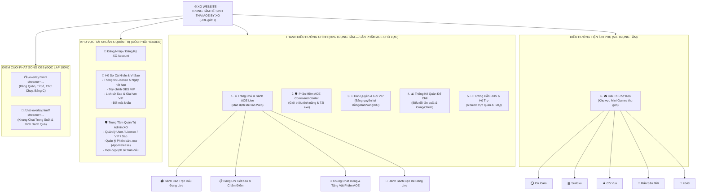
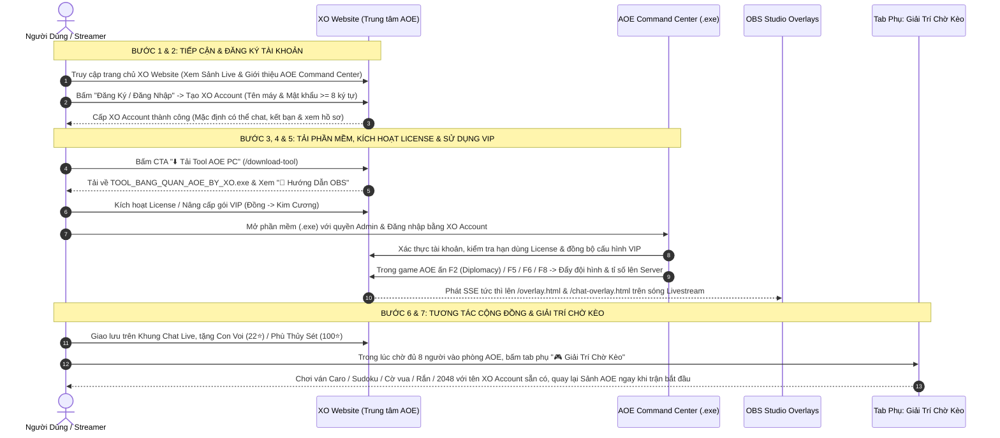

# 🗺️ THIẾT KẾ CẤU TRÚC WEBSITE & HÀNH TRÌNH NGƯỜI DÙNG (`WEBSITE_SITEMAP.md`)

> **Giai đoạn:** TASK 2 — Thiết Kế Cấu Trúc Website & Trải Nghiệm Người Dùng (Chưa can thiệp mã nguồn)  
> **Định hướng cốt lõi:** Website là Trung tâm Sản phẩm **AOE Command Center** (Giới thiệu, Tải phần mềm, Tài khoản, License/VIP, Sảnh Live, Hướng dẫn & Hỗ trợ). Mini Games chỉ xuất hiện trong mục phụ `"🎮 Giải Trí Chờ Kèo"`.

---

## 1. HIỆN TRẠNG GIAO DIỆN & ĐIỀU HƯỚNG WEBSITE (CURRENT STATE)

Qua khảo sát [`public/index.html`](file:///c:/Users/APC/.gemini/antigravity/scratch/aoetrackerv2/public/index.html) (3.527 dòng), cấu trúc hiện tại như sau:
1. **Thanh Header trên cùng (`dòng 133–254`)**:
   - Đang đặt hơn 7 nút bấm nằm ngang cùng cấp: `Sảnh Kèo Đấu`, `Thống Kê Quân`, `Tải Tool PC`, `Hướng Dẫn OBS`, `🧋 Donate`, cụm nút Tài khoản (`Thông tin TK`, `Cấu hình OBS`, `Đăng xuất` / `Đăng nhập`) và `Quản trị Admin`.
2. **Nội dung Trang chủ (`currentTab === 'matches'`, `dòng 441–686`)**:
   - Người dùng vừa mở trang web là vào thẳng danh sách `🏟️ SẢNH CÁC TRẬN ĐẤU ĐANG LIVE` và danh sách lịch sử kèo đấu.
   - **Thiếu sót hiện tại**:
     - Chưa có khu vực **Giới thiệu Sản phẩm AOE Command Center (Product Hero & Feature Showcase)** dành cho khách mới vào web lần đầu để hiểu phần mềm làm gì.
     - Chưa có **Bảng Quyền Lợi License & Gói VIP (`Đồng / Bạc / Vàng / Kim Cương`)** hiển thị trực quan trên trang để thúc đẩy chuyển đổi nâng cấp VIP.
     - Chưa có form **Đăng ký Tài khoản mới (Self-Registration)** — hiện khách muốn có tài khoản phải liên hệ Admin tạo thủ công.

---

## 2. SITEMAP & CẤU TRÚC ĐIỀU HƯỚNG ĐỀ XUẤT (PROPOSED SITEMAP)

### 2.1. Sơ Đồ Cây Cấu Trúc XO Website Mới (Information Architecture)

---

### 2.2. Bố Cục Chi Tiết Trang Chủ (`/`) — Tối Ưu Hóa Cho AOE Command Center

Trang chủ được chia thành 4 tầng nội dung rõ ràng theo thứ tự ưu tiên từ trên xuống dưới:

1. **Tầng 1 — Thanh Header Chuẩn Esports (Sticky Top Bar)**:
   - **Cụm Trái**: Biểu tượng Khiên Vàng `logo.svg` + Thương hiệu **AOE BY XO** + Huy hiệu `🔴 X Trận Đang Live`.
   - **Cụm Giữa (Menu Điều Hướng)**:
     1. `⚔️ Sảnh AOE Live` *(Active mặc định)*
     2. `🛡️ Phần Mềm & VIP` *(Cuộn mượt xuống khu vực Giới thiệu Tool & Bảng quyền lợi VIP)*
     3. `📊 Thống Kê Quân`
     4. `📖 Hướng Dẫn & Hỗ Trợ`
     5. `🎮 Giải Trí Chờ Kèo` *(Nút phụ viền mảnh, không dùng màu vàng CTA chính)*
   - **Cụm Phải**:
     - Nút CTA Vàng Hoàng Gia nổi bật nhất: **`⬇️ Tải Tool AOE PC (v5.4.0)`** (`/download-tool`).
     - Cụm Tài khoản: Nút `Đăng Nhập / Đăng Ký` (khi chưa đăng nhập) hoặc Pill Tài khoản hiển thị `Tên Máy • Hạng VIP • Số dư ⭐` kèm menu thả xuống (`👤 Hồ sơ & License`, `⚙️ Cấu hình OBS VIP`, `🛡️ Quản trị Admin`, `🚪 Đăng xuất`).

2. **Tầng 2 — Hero Showcase Thu Gọn (Có thể đóng/mở)**:
   - Hiển thị tóm tắt 3 điểm mạnh độc quyền của **AOE Command Center**:
     - `🎯 Tự động quét Bảng Quân & Màu Cờ khi ấn Diplomacy (F2)`
     - `⚡ Chấm tỉ số tức thì bằng phím tắt F5 / F6 & Hiệu ứng F8 trong game`
     - `📺 Đồng bộ 2 Link OBS Trong Suốt & Hút Comment Facebook Group Live`
   - Kèm 2 nút hành động: **`⬇️ Tải Phần Mềm Windows (.exe)`** và **`👑 Xem Bảng Quyền Lợi VIP`**. *(Đối với Streamer đã đăng nhập và đang thao tác kèo, banner này tự động thu gọn thành 1 thanh công cụ copy nhanh Link OBS).*

3. **Tầng 3 — Không Gian Sảnh Đấu & Tương Tác Cộng Đồng AOE (12 Cột)**:
   - **Cột Chính (8/12 cột)**:
     - `🏟️ SẢNH CÁC TRẬN ĐẤU ĐANG LIVE` (Card trận đấu trực tiếp, nút vào sảnh, tặng Voi/Phù Thủy Sét).
     - Danh sách & Bộ lọc toàn bộ Kèo Đấu (`Đang LIVE` / `Đã kết thúc`) hoặc Chi tiết trận đấu đang chọn.
   - **Cột Phải (4/12 cột)**:
     - Khung **Chat Live & Ngăn Kéo 6 Vật Phẩm Đế Chế** (kèm nút `🔵 Kết nối FB Live` và `📌 Ghim`).
     - Khung **Bạn Bè & Trạng Thái Đang Live**.

4. **Tầng 4 — Khu Vực Giới Thiệu Tính Năng, Bảng Quyền Lợi License/VIP & Hỗ Trợ**:
   - **Bảng So Sánh 4 Hạng VIP (`Đồng / Bạc / Vàng / Kim Cương`)**: Liệt kê rõ từng tính năng mở khóa trên phần mềm AOE Command Center và OBS Overlay kèm nút hướng dẫn kích hoạt/gia hạn.
   - **Khu vực Hỗ trợ & Liên hệ Admin**: Hướng dẫn xử lý lỗi thường gặp (Run as Administrator, DPI màn hình, cài đặt OBS Browser Source).

---

## 3. HÀNH TRÌNH NGƯỜI DÙNG (END-TO-END USER JOURNEY)

---

## 4. LÝ DO LỰA CHỌN, ƯU ĐIỂM, NHƯỢC ĐIỂM & RỦI RO

### 4.1. Lý Do Lựa Chọn Cấu Trúc Sitemap Này
- Đặt **AOE Command Center** và **Sảnh AOE Live** ở vị trí trung tâm (Default Landing View), đáp ứng đúng nhu cầu của cả hai nhóm đối tượng chính:
  1. **Streamer / Người chơi AOE**: Vào web lấy link OBS, xem tỉ số, quản lý VIP và tải bản cập nhật mới nhất chỉ với 1 cú nhấp chuột.
  2. **Khán giả xem kèo**: Vào web theo dõi ngay các kèo đang Live, bình luận và tặng vật phẩm cổ vũ.
- Cô lập hoàn toàn 5 trò chơi phụ vào tab `"🎮 Giải Trí Chờ Kèo"`, giữ cho giao diện chính luôn mang đậm bản sắc Đế Chế chuyên nghiệp.

### 4.2. Ưu Điểm & Nhược Điểm
- **Ưu điểm**:
  - Giảm sự lộn xộn trên thanh Header (từ 7+ nút rời rạc xuống 5 tab điều hướng rõ ràng + 1 nút CTA tải phần mềm + 1 menu tài khoản).
  - Bổ sung đầy đủ điểm chạm thương mại (Giới thiệu tính năng + Bảng so sánh VIP + Hồ sơ License) mà trước đây Website còn thiếu.
  - Khi người dùng đang ở tab `"🎮 Giải Trí Chờ Kèo"`, thanh Header trên cùng vẫn hiển thị huy hiệu **`🔴 X Trận AOE Đang Live`** để họ có thể bấm quay lại sảnh AOE bất kỳ lúc nào.
- **Nhược điểm**:
  - Tăng nhẹ chiều dài mã HTML của [`public/index.html`](file:///c:/Users/APC/.gemini/antigravity/scratch/aoetrackerv2/public/index.html) nếu viết chung một file (có thể giải quyết bằng cách tách các file JS/CSS tĩnh trong `public/`).

### 4.3. Rủi Ro & Biện Pháp Kiểm Soát
- **Rủi ro (Thói quen của người dùng cũ)**: Những người dùng đã quen nhìn thanh nút bấm cũ trên Header có thể cần 1–2 lần sử dụng để làm quen với menu tài khoản gom nhóm.
  - *Biện pháp kiểm soát*: Giữ nguyên tên gọi và biểu tượng quen thuộc (`⚔️ Sảnh Kèo Đấu`, `⬇️ Tải Tool PC`, `🖥️ Link OBS`, `💬 OBS Chat`, `📖 Hướng Dẫn OBS`).

---

## 5. CÁC MODULE BỊ ẢNH HƯỞNG & PHƯƠNG ÁN ROLLBACK

- **Các module bị ảnh hưởng**:
  - Duy nhất [`public/index.html`](file:///c:/Users/APC/.gemini/antigravity/scratch/aoetrackerv2/public/index.html) và [`public/brand-tokens.css`](file:///c:/Users/APC/.gemini/antigravity/scratch/aoetrackerv2/public/brand-tokens.css).
  - Không ảnh hưởng tới [`public/overlay.html`](file:///c:/Users/APC/.gemini/antigravity/scratch/aoetrackerv2/public/overlay.html), [`public/chat-overlay.html`](file:///c:/Users/APC/.gemini/antigravity/scratch/aoetrackerv2/public/chat-overlay.html) hay [`client/bangquanaoe.py`](file:///c:/Users/APC/.gemini/antigravity/scratch/aoetrackerv2/client/bangquanaoe.py).
- **Phương án Rollback**:
  - Sử dụng cơ chế chuyển tab của Vue 3 (`currentTab`). Nếu cần ẩn tab mới hoặc khôi phục bố cục Header cũ, chỉ cần revert phần template Header trong `public/index.html` mà không ảnh hưởng đến bất kỳ logic dữ liệu nào.

