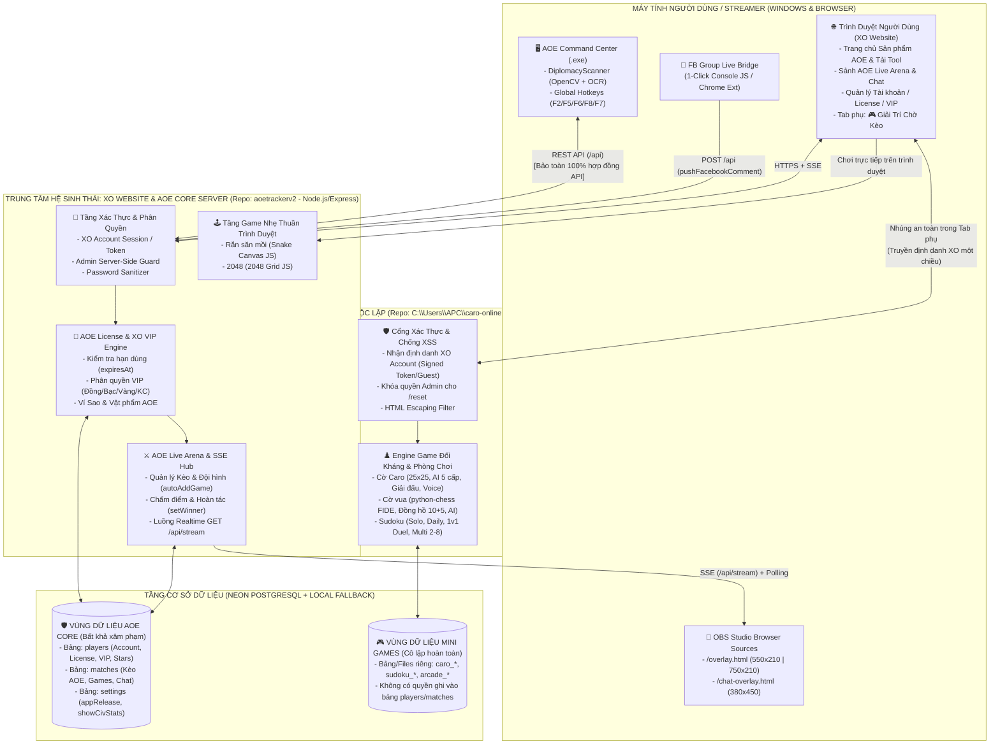

# 🏛️ KIẾN TRÚC TỔNG THỂ HỆ SINH THÁI XO (`XO_ARCHITECTURE.md`)

> **Giai đoạn:** TASK 2 — Thiết Kế Kiến Trúc Tổng Thể (Chưa can thiệp mã nguồn)  
> **Nguyên tắc bất biến:** Giữ nguyên các repository hiện tại • Không gộp thành 1 codebase khổng lồ • Bảo vệ tuyệt đối AOE Core • Cô lập hoàn toàn Mini Games khỏi nghiệp vụ AOE.

---

## 1. HIỆN TRẠNG KIẾN TRÚC (CURRENT STATE)

Hiện tại 3 dự án đang vận hành theo 2 cụm độc lập:
1. **Cụm AOE (`aoetrackerv2` / `aoe-tracker`)**:
   - **AOE Command Center (`client/bangquanaoe.py` / `.exe`)**: Phần mềm desktop Windows đọc màn hình game AOE 1, nhận phím tắt `F2/F5/F6/F8/F7` và giao tiếp với Server qua HTTP REST (`GET/POST /api`).
   - **XO Website & API Server (`server/index.js`, `server/db.js`, `public/*.html`)**: Chạy trên Node.js + Express, dùng cơ sở dữ liệu **Neon PostgreSQL** (fallback về `local_db.json`), phục vụ đồng thời giao diện Web (`public/index.html`) và 2 nguồn phát sóng OBS (`public/overlay.html`, `public/chat-overlay.html`) qua giao thức **Server-Sent Events (`GET /api/stream`)** kết hợp HTTP Polling dự phòng.
2. **Cụm Mini Games (`C:\Users\APC\caro-online`)**:
   - Chạy trên một máy chủ Python riêng biệt (`caro_lan.py` dùng `ThreadingHTTPServer`), phục vụ các trò chơi trên trình duyệt, tự quản lý phòng chơi trong RAM và lưu trữ lịch sử/bảng xếp hạng vào các bảng Postgres riêng hoặc file `.json` cục bộ.

---

## 2. KIẾN TRÚC TỔNG THỂ ĐỀ XUẤT (PROPOSED TARGET ARCHITECTURE)

### 2.1. Mô Hình Kiến Trúc Phân Lớp & Cô Lập Nghiệp Vụ (Modular Federated Architecture)

Kiến trúc mục tiêu giữ nguyên **3 repository riêng biệt**, định nghĩa rõ ranh giới của **9 thành phần cốt lõi**:
1. **AOE Command Center (Windows Client)**: Ứng dụng thực thi trên máy Streamer/Game thủ.
2. **OBS Integration Layer**: 2 trang hiển thị thời gian thực nhúng vào OBS Studio (`/overlay.html`, `/chat-overlay.html`).
3. **AOE Live Arena**: Phân hệ quản lý kèo đấu đang phát sóng, bảng tỉ số, lịch sử trận, khung chat trận đấu và hiệu ứng vinh danh vật phẩm Đế Chế.
4. **XO Account (Identity Service)**: Quản lý danh tính người dùng thống nhất trong hệ sinh thái.
5. **AOE License Engine**: Kiểm tra trạng thái kích hoạt (`isActive`) và thời hạn bản quyền (`expiresAt`) dành riêng cho quyền sử dụng phần mềm AOE Command Center.
6. **XO VIP & Star Wallet Engine**: Quản lý 4 hạng VIP (`BRONZE`, `SILVER`, `GOLD`, `DIAMOND`) và Quỹ Sao (`starsBalance`, `starsReceived`, `starHistory`).
7. **XO Website (Frontend Hub)**: Cổng giao diện trung tâm của hệ sinh thái.
8. **XO Mini Games Subsystem**: Phân hệ tiện ích giải trí phụ trợ (`🎮 Giải Trí Chờ Kèo`) gồm 5 game (**Caro, Sudoku, Cờ vua, Rắn săn mồi, 2048**), được cô lập hoàn toàn về trạng thái và dữ liệu.
9. **Backend & Database Layer**: Tầng lưu trữ phân tách rõ vùng dữ liệu AOE Core và vùng dữ liệu Mini Games.

### 2.2. Sơ Đồ Kiến Trúc Tổng Thể Hệ Sinh Thái XO

---

## 3. RANH GIỚI ĐỘC LẬP, CHIA SẺ DỮ LIỆU & BẢO VỆ AOE CORE

### 3.1. Bảng Phân Định Ranh Giới Giữa Các Thành Phần

| Thành phần | Trạng thái độc lập | Dữ liệu được phép chia sẻ | Dữ liệu & Nghiệp vụ PHẢI tách biệt tuyệt đối |
| :--- | :--- | :--- | :--- |
| **AOE Command Center (`client/`)** | Độc lập hoàn toàn trên máy Windows của người dùng; chỉ giao tiếp qua `/api`. | `playerName`, trạng thái đăng nhập, `tier`, `expiresAt`, `overlayConfig`, dữ liệu kèo đấu `matches` và `chatMessages`. | Không tải hoặc chạy bất kỳ mã nguồn nào của Mini Games; không nhận sự kiện từ Mini Games vào `_background_worker`. |
| **OBS Integration (`overlay.html`, `chat-overlay.html`)** | Độc lập hoàn toàn (Static HTML/Vue nhận luồng SSE `/api/stream`). | Dữ liệu trận đấu `currentMatch`, `overlayConfig`, `star_gifted`, `hype_shout`, `chat_message` của riêng Streamer đó. | Tuyệt đối không nhận sự kiện hay thông báo nào từ khu vực Mini Games. |
| **XO Website — AOE Core (`server/index.js`)** | Trụ cột chính trên Node.js. | Cung cấp thông tin định danh hiển thị (`displayName`, `tierBadge`) một chiều sang khu vực Mini Games. | Bảng `players` (mật khẩu, hạn dùng `expiresAt`, `starsBalance`), bảng `matches` và `settings` chỉ do `server/index.js` đọc/ghi. |
| **XO Mini Games (`caro-online` + Static Games)** | Cô lập trong khu vực phụ `/minigames` (hoặc service riêng). | Chỉ nhận `displayName` và `tierBadge` (hoặc chơi dưới tên Khách). | Bảng điểm, phòng chơi Caro/Cờ vua/Sudoku, lịch sử ván cờ lưu ở vùng dữ liệu riêng; **không có quyền ghi vào bảng `players` hay `matches` của AOE**. |

### 3.2. Những Điểm Không Được Phép Ảnh Hưởng Đến AOE Core (Red Lines)
1. **Không thay đổi đường dẫn và cấu trúc JSON của `GET /api`, `POST /api`, `GET /api/stream`, `/overlay.html`, `/chat-overlay.html`, `/download-tool`**: Đảm bảo các bản `.exe` đang chạy trên máy người dùng không bao giờ bị lỗi tương thích.
2. **Không dùng chung luồng SSE `/api/stream` của AOE cho Mini Games**: Tránh làm nghẽn băng thông hoặc đẩy nhầm sự kiện game phụ vào OBS của Streamer AOE.
3. **Không dùng chung khóa đồng bộ hoặc tiến trình xử lý ảnh**: Mọi tác vụ của Mini Games không được phép làm tăng độ trễ của API `autoAddGame`, `setWinner`, `heartbeat`.

---

## 4. LÝ DO LỰA CHỌN, ƯU ĐIỂM, NHƯỢC ĐIỂM & RỦI RO

### 4.1. Lý Do Lựa Chọn Kiến Trúc Liên Hợp Cô Lập (Federated & Isolated Architecture)
- Tuân thủ tuyệt đối nguyên tắc **không gộp 3 repository thành một codebase khổng lồ** và **không viết lại các hệ thống đang chạy tốt** (`DiplomacyScanner` của AOE Command Center, hệ thống OBS SSE của XO Website, và bộ luật FIDE `python-chess` / AI Caro / Sudoku Duel của `caro-online`).
- Kết hợp ưu thế của cả hai thế giới: các game giải trí cá nhân siêu nhẹ (**Rắn săn mồi, 2048**) chạy ngay trên trình duyệt không tốn tài nguyên máy chủ, trong khi các game đối kháng phức tạp (**Caro, Cờ vua, Sudoku**) giữ nguyên sức mạnh từ service `caro-online` độc lập.

### 4.2. Ưu Điểm & Nhược Điểm
- **Ưu điểm**:
  - **An toàn cao cho AOE Core**: Dù dịch vụ Mini Games có bảo trì, khởi động lại hay quá tải, phần mềm **AOE Command Center**, **Sảnh Live AOE** và **OBS Overlay** vẫn hoạt động bình thường 100%.
  - **Tiết kiệm công sức phát triển**: Tái sử dụng 100% logic game đã được kiểm chứng qua unit test (`test_caro_features.py`, `test_caro_lan.py`, `test_sudoku_multi_features.py`).
  - **Dễ nâng cấp từng phần**: Có thể cập nhật `.exe` của AOE, giao diện Website, hoặc luật chơi Caro hoàn toàn độc lập.
- **Nhược điểm**:
  - Nếu muốn chơi các tính năng đối kháng nhiều người (Multiplayer/Giải đấu/Đấu máy sâu) của **Caro, Cờ vua, Sudoku**, cần duy trì service Python `caro-online` chạy song song với service Node.js của Website (hoặc định tuyến qua proxy).

### 4.3. Rủi Ro & Biện Pháp Kiểm Soát
- **Rủi ro 1 (Chia sẻ cùng một instance Neon PostgreSQL)**: Nếu cả `server/index.js` và `caro_lan.py` cùng kết nối tới một database Neon Free Tier, cách mở kết nối rời rạc (`psycopg.connect` mỗi request) của `caro_lan.py` có thể làm chạm ngưỡng giới hạn kết nối đồng thời của Neon.
  - *Biện pháp kiểm soát*: Giới hạn số kết nối hoặc tách schema/database riêng trên Neon cho Mini Games, và ưu tiên bộ nhớ đệm RAM cho bảng xếp hạng Mini Games.
- **Rủi ro 2 (Lỗ hổng bảo mật tồn đọng)**: Các lỗ hổng đã phát hiện ở Task 1 (`WEB-01`, `WEB-02`, `MG-01`, `MG-02`) nếu không được vá trước khi mở kết nối sẽ tạo bề mặt tấn công.
  - *Biện pháp kiểm soát*: Thực thi bắt buộc **Checklist Vá Bảo Mật** ở Giai đoạn 1 trước khi mở tính năng tích hợp.

---

## 5. CÁC MODULE BỊ ẢNH HƯỞNG & PHƯƠNG ÁN ROLLBACK

- **Các module bị ảnh hưởng khi triển khai**:
  - **XO Website (`server/index.js` & `public/index.html`)**: Vá bảo mật xác thực, thêm tab điều hướng phụ `🎮 Giải Trí Chờ Kèo` và cơ chế cấp vé định danh tạm thời (`short-lived signed ticket`) cho Mini Games.
  - **Mini Games (`C:\Users\APC\caro-online`)**: Vá lỗ hổng `/reset` và XSS, ẩn 2 game ngoài phạm vi (`gold-miner`, `ceo-survival`) khỏi registry hiển thị, và áp dụng bộ màu giao diện `XO Obsidian-Gold`.
  - **AOE Command Center (`client/bangquanaoe.py`)**: Chỉ vá lỗi nhỏ (`import datetime`, mở rộng danh sách sảnh), không thay đổi kiến trúc.
- **Phương án Rollback**:
  - Do 3 project giữ nguyên repository riêng và giao tiếp lỏng qua cổng phụ `/minigames`, bất kỳ lúc nào cần rollback chỉ cần tắt tab `🎮 Giải Trí Chờ Kèo` thông qua một biến cấu hình (`enableMiniGames: false` trong `settings`), toàn bộ hệ thống lập tức quay về trạng thái thuần AOE ban đầu trong vòng 5 giây mà không mất dữ liệu.

