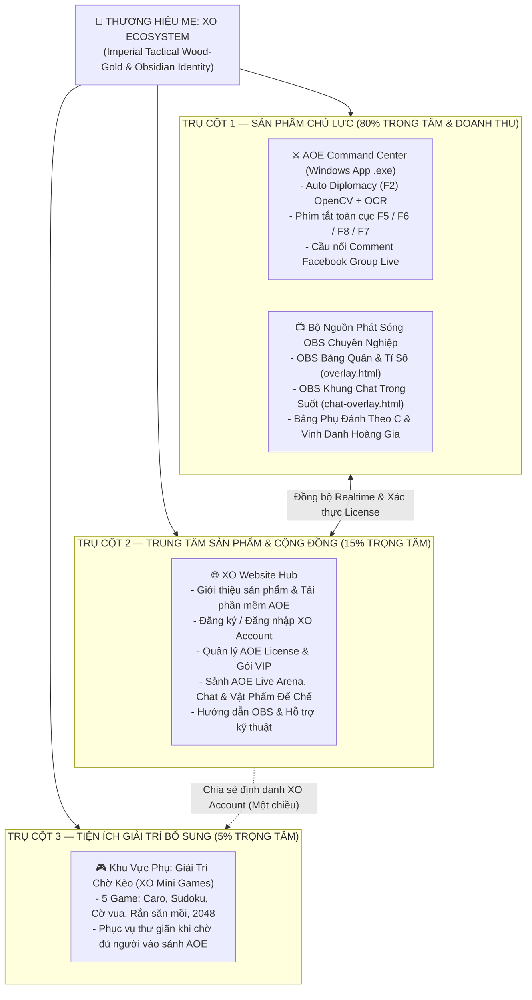

# 🎯 CHIẾN LƯỢC SẢN PHẨM & MÔ HÌNH KINH DOANH HỆ SINH THÁI XO (`XO_PRODUCT_STRATEGY.md`)

> **Giai đoạn:** TASK 2 — Thiết Kế Kiến Trúc & Chiến Lược Sản Phẩm (Chưa can thiệp mã nguồn)  
> **Thương hiệu mẹ:** **XO Ecosystem**  
> **Sản phẩm chủ lực (Flagship):** **AOE Command Center (`TOOL BẢNG QUÂN AOE BY XO`)**

---

## 1. HIỆN TRẠNG (CURRENT STATE)

### 1.1. Hiện Trạng Danh Mục Sản Phẩm
Hệ thống hiện có 3 dự án đang tồn tại độc lập trên máy tính:
1. **AOE Command Center (`client/bangquanaoe.py` & `.exe` — `v5.4.0`)**:
   - Phần mềm Windows chuyên dụng cho Streamer, Bình luận viên và Game thủ cộng đồng Age of Empires 1 (Rise of Rome).
   - Sở hữu công nghệ cốt lõi độc quyền: tự động quét bảng quân, màu cờ và phe đồng minh/đối thủ khi mở hộp thoại `Diplomacy (F2)` bằng Computer Vision (OpenCV + WinRT OCR), bắt phím tắt toàn cục (`F5`, `F6`, `F8`, `F7`), đồng bộ thời gian thực lên OBS Overlay và Sảnh Live.
2. **XO Website (`server/index.js` & `public/*.html` — `v5.4.0`)**:
   - Đang đóng vai trò vừa là Backend API/SSE cho phần mềm AOE Command Center & 2 nguồn OBS (`overlay.html`, `chat-overlay.html`), vừa là giao diện Sảnh Kèo Đấu Đang Live, Khung Chat & Tặng Vật Phẩm Đế Chế, Quản lý tài khoản/VIP và Tải phần mềm (`/download-tool`).
   - Hiện tại trang chủ đang đi thẳng vào danh sách kèo đấu (`Sảnh Kèo Đấu Đang Live`), chưa có khu vực giới thiệu sản phẩm (Product Showcase), bảng so sánh quyền lợi License/VIP rõ ràng cho người dùng mới, và chưa có luồng đăng ký tài khoản tự động.
3. **Mini Games (`C:\Users\APC\caro-online`)**:
   - Một repository Python độc lập chứa các trò chơi giải trí trên trình duyệt. Theo phạm vi đã chốt, 5 trò chơi được đưa vào quy hoạch tiện ích phụ gồm: **Cờ Caro**, **Sudoku**, **Cờ vua**, **Rắn săn mồi**, và **2048**.

### 1.2. Vấn Đề Chiến Lược Cần Giải Quyết
- Chưa có sự phân tầng rõ ràng giữa **Thương hiệu mẹ (XO)**, **Sản phẩm thương mại chủ lực (AOE Command Center)** và **Tiện ích giải trí cộng đồng (XO Mini Games)**.
- Người dùng mới vào Website chưa thấy ngay giá trị vượt trội của phần mềm **AOE Command Center**, quy trình tải phần mềm – kích hoạt License – nâng cấp VIP còn phụ thuộc nhiều vào thao tác thủ công qua Admin.
- Cần tích hợp 5 Mini Games làm tiện ích giữ chân người xem/game thủ trong lúc chờ kèo AOE mà **tuyệt đối không biến Website thành cổng game tổng hợp** hay làm lu mờ sản phẩm AOE.

---

## 2. KIẾN TRÚC CHIẾN LƯỢC SẢN PHẨM ĐỀ XUẤT (PROPOSED PRODUCT STRATEGY)

### 2.1. Phân Tầng Hệ Sinh Thái XO (3-Tier Product Hierarchy)

### 2.2. Quy Tắc Tỷ Trọng Hiển Thị & Điều Hướng (80 / 15 / 5 Rule)
1. **80% Trọng tâm Giao diện & Truyền thông dành cho AOE Command Center**:
   - Mọi điểm chạm đầu tiên trên Website (Hero Banner, Nút CTA chính màu Vàng Hoàng Gia, Sảnh Trận Đấu Đang Live, Bảng Quyền Lợi VIP, Hướng Dẫn Cài Đặt OBS) đều phục vụ trực tiếp cho phần mềm **AOE Command Center**.
2. **15% Trọng tâm dành cho Tương tác Cộng đồng AOE & Quản lý Tài khoản**:
   - Khung Chat Live theo trận, Tặng Vật Phẩm Đế Chế (`Con Voi`, `Phù Thủy Sét`, `Song Mã`, `Bơm Thực/Gỗ`), Thống kê tỷ lệ Quân Cung/Chém, Bạn bè đang Live và Hồ sơ cá nhân.
3. **5% Trọng tâm dành cho Tiện ích phụ `"🎮 Giải Trí Chờ Kèo"`**:
   - Chỉ hiển thị dưới dạng **một mục điều hướng phụ thứ cấp** trên thanh menu (`🎮 Giải Trí Chờ Kèo`).
   - Không đặt banner quảng cáo Mini Games trên trang chủ AOE, không đẩy thông báo Mini Games vào khung chat trận đấu AOE hay lên OBS Overlay của Streamer.

---

## 3. ĐỊNH HƯỚNG MÔ HÌNH KINH DOANH (BUSINESS & MONETIZATION MODEL)

> *Lưu ý nguyên tắc: Tài liệu chỉ đề xuất cấu trúc mô hình kinh doanh và phân tích ưu/nhược điểm, không tự ý áp đặt mức giá cụ thể.*

### 3.1. Ma Trận Quyền Lợi: AOE License & Phân Hạng VIP
Hệ thống tách bạch rõ **Danh tính tài khoản (`XO Account` — Miễn phí)** và **Quyền sử dụng thương mại (`AOE License & VIP Tier`)**:

| Cấp độ | Đối tượng mục tiêu | Quyền lợi trên XO Website & Cộng đồng | Quyền lợi trên Phần mềm AOE Command Center & OBS |
| :--- | :--- | :--- | :--- |
| **Khách (Guest / Chưa đăng nhập)** | Khán giả xem kèo vãng lai | - Xem Sảnh AOE Live Arena & lịch sử kèo đấu. - Xem thống kê Quân. - Tải bộ cài phần mềm & đọc hướng dẫn. - Chơi thử Mini Games ở chế độ khách. | - Không thể đăng nhập vào phần mềm AOE Command Center. |
| **XO Account (Free Member / Chưa kích hoạt License hoặc Hết hạn)** | Khán giả cố định, người chơi cộng đồng | - Bình luận trên Sảnh Chat Live AOE. - Kết bạn, theo dõi bạn bè đang Live. - Nạp & sử dụng Sao tặng Vật phẩm Đế Chế. - Lưu điểm xếp hạng & tên cố định trong Mini Games. | - Đăng nhập xem Sảnh Live trên App PC, hoặc được cấp gói **Dùng thử (Trial License)** theo số ngày quy định để trải nghiệm quét bảng quân F2. |
| **🥉 Hạng Đồng (`BRONZE` License)** | Người chơi AOE & Streamer cơ bản | - Toàn bộ quyền lợi thành viên XO Account. - Huy hiệu Hạng Đồng trên khung Chat. | - **Mở khóa AOE Command Center**: Quét Diplomacy (`F2`) tự động, chấm tỉ số `F5`/`F6`, hiệu ứng `F8`. - Sử dụng 2 Link OBS (`Bảng Quân` + `Khung Chat`) tiêu chuẩn. - Khung Ảo căn chỉnh OBS (`showIdlePreview`). |
| **🥈 Hạng Bạc (`SILVER` VIP)** | Streamer bán chuyên | - Huy hiệu Hạng Bạc nổi bật. | - Toàn bộ quyền lợi Hạng Đồng. - Tùy chỉnh mốc điểm kèo đấu (`Chạm X`). - Bật/Tắt hiển thị Ngày tháng góc phải trên OBS. |
| **🥇 Hạng Vàng (`GOLD` VIP)** | Streamer thường xuyên & Bình luận viên | - Huy hiệu Hạng Vàng. - Ưu tiên nổi bật phòng Live trên Sảnh. | - Toàn bộ quyền lợi Hạng Bạc. - Mở khóa **Chữ chạy Marquee tùy chỉnh** trên OBS (`Tổng Cung-Chém`, `Từng người`, hoặc chạy dòng chữ quảng cáo/thông tin Donate riêng). |
| **💎 Hạng Kim Cương (`DIAMOND` VIP)** | Streamer chuyên nghiệp, Clan & Đơn vị tổ chức giải | - Huy hiệu Kim Cương Hoàng Gia. - Vị trí danh dự trên Sảnh Live Arena. | - Toàn bộ quyền lợi Hạng Vàng. - Mở khóa **Chế độ Đánh theo C (`Séc 1, Séc 2, Séc 3...`)** kèm bảng phụ thống kê tỉ số từng C trên OBS (`750x210`). |

### 3.2. So Sánh 3 Mô Hình Kinh Doanh Đề Xuất

| Mô hình kinh doanh | Cơ chế vận hành | Ưu điểm | Nhược điểm | Đánh giá phù hợp |
| :--- | :--- | :--- | :--- | :--- |
| **Mô hình 1: Thuê bao License theo Thời hạn + Phân bậc VIP (Time-based Tiered Subscription)** | Người dùng đăng ký gói theo chu kỳ (`Tháng / Quý / Năm`) gắn liền với hạng VIP (`Đồng / Bạc / Vàng / Kim Cương`). Có thể kèm gói dùng thử ngắn hạn cho tài khoản mới. | - Tạo dòng doanh thu định kỳ ổn định để duy trì Server/Database. - Khớp 100% với cấu trúc `tier` + `expiresAt` sẵn có trong code hiện tại (`server/db.js`). | - Người dùng ít chơi có thể ngại gia hạn theo tháng nếu không có gói ngắn ngày linh hoạt. | **KHUYẾN NGHỊ CHÍNH (Core Model)** |
| **Mô hình 2: Freemium Cơ bản + Thuê bao Tính năng VIP Nâng cao** | Cho phép quét bảng quân cơ bản miễn phí (có gắn watermark thương hiệu `AOE BY XO`), thu phí khi nâng cấp lên `Bạc / Vàng / Kim Cương` (tùy chỉnh Chạm X, Chữ chạy quảng cáo riêng, Đánh theo C). | - Tốc độ lan tỏa (Viral) phần mềm cực nhanh trong cộng đồng AOE. - Mọi Streamer đều gắn overlay `AOE BY XO` lên sóng livestream. | - Tăng tải cho Server từ lượng người dùng miễn phí. - Cần kiểm soát giới hạn tần suất (Rate-limit) chặt chẽ hơn. | **Rất tốt để mở rộng thị phần nhanh** |
| **Mô hình 3: Hệ sinh thái Kết hợp (License/VIP + Kinh tế Vật Phẩm Sao Cộng Đồng)** | Kết hợp Mô hình 1/2 với việc người xem nạp **Quỹ Sao (`starsBalance`)** để tặng **Vật phẩm Đế Chế (`Voi Điên`, `Phù Thủy Sét`, `Song Mã`)** vinh danh trên sóng OBS của Streamer. | - Đa dạng hóa nguồn thu từ cả **Streamer (mua VIP)** lẫn **Khán giả (nạp Sao cổ vũ)**. - Tăng gắn kết cộng đồng AOE. | - Cần quy trình đối soát nạp Sao minh bạch (đã có sẵn bảng `starHistory` trong DB). | **KHUYẾN NGHỊ KẾT HỢP DÀI HẠN** |

### 3.3. Vai Trò Của Mini Games Trong Mô Hình Kinh Doanh
- **Hoàn toàn miễn phí (Free-to-Play Utility)**: Không thu phí chơi Mini Games, không bán vật phẩm trong Mini Games để tránh phân tán mục tiêu thương mại.
- **Giá trị gián tiếp**:
  1. Giữ chân người dùng ở lại trên tab XO Website trong thời gian chờ Streamer gom đủ 8 người vào phòng AOE (thường mất 10–20 phút giữa các kèo).
  2. Khuyến khích khán giả tạo **XO Account** (để lưu điểm kỷ lục Sudoku/2048/Rắn hoặc Elo Caro), từ đó chuyển đổi họ thành người bình luận và tặng Sao trên Sảnh AOE Live.

---

## 4. LÝ DO LỰA CHỌN, ƯU ĐIỂM, NHƯỢC ĐIỂM & RỦI RO

### 4.1. Lý Do Lựa Chọn Định Hướng Này
- Bảo vệ tuyệt đối giá trị cốt lõi của **AOE Command Center** — sản phẩm duy nhất tạo ra sự khác biệt công nghệ (OpenCV Diplomacy Scanner + OBS Broadcast Suite) và doanh thu bản quyền thực tế.
- Tận dụng trọn vẹn tài sản sẵn có của cả 3 project mà không phải đập đi xây lại.

### 4.2. Ưu Điểm & Nhược Điểm
- **Ưu điểm**:
  - Định vị thương hiệu rõ ràng: Nhắc đến **XO** là nhắc đến bộ công cụ chuẩn mực cho Đế Chế (AOE).
  - Tối ưu tỷ lệ chuyển đổi (Conversion Rate) từ khách truy cập Web thành người tải phần mềm `.exe` và đăng ký VIP.
  - Cấu trúc dữ liệu `tier`, `expiresAt`, `starsBalance`, `vipHistory`, `starHistory` hiện có đáp ứng ngay lập tức mô hình kinh doanh mà không phải thiết kế lại cơ sở dữ liệu.
- **Nhược điểm**:
  - Đòi hỏi giao diện trang chủ Website phải được sắp xếp lại khoa học hơn để vừa hiển thị Sảnh Kèo Đấu Live vừa truyền tải rõ thông điệp sản phẩm & bảng quyền lợi VIP.

### 4.3. Rủi Ro & Biện Pháp Giảm Thiểu
- **Rủi ro 1 (Lệch trọng tâm sang Mini Games)**: Nếu đặt lối vào Mini Games quá nổi bật, người dùng có thể hiểu nhầm Website là trang web chơi game giải trí thông thường.
  - *Giảm thiểu*: Cố định Mini Games ở tab phụ thứ cấp `"🎮 Giải Trí Chờ Kèo"`, dùng tông màu trung tính hơn so với nút CTA Vàng Hoàng Gia của `⬇️ Tải Tool AOE PC`.
- **Rủi ro 2 (Trải nghiệm kích hoạt tài khoản mới)**: Hiện tại người dùng mới chưa tự đăng ký được trên Web mà phải nhắn Admin tạo tay.
  - *Giảm thiểu*: Thiết kế bổ sung luồng tự đăng ký tài khoản `XO Account` (mặc định chưa kích hoạt License thương mại hoặc cấp gói dùng thử có kiểm soát) trong giai đoạn nâng cấp tiếp theo.

---

## 5. CÁC MODULE BỊ ẢNH HƯỞNG & PHƯƠNG ÁN ROLLBACK

- **Các module dự kiến bị ảnh hưởng khi triển khai Chiến lược này**:
  - Giao diện trang chủ [`public/index.html`](file:///c:/Users/APC/.gemini/antigravity/scratch/aoetrackerv2/public/index.html) (bổ sung khu vực giới thiệu sản phẩm AOE Command Center, bảng quyền lợi VIP và tab phụ `🎮 Giải Trí Chờ Kèo`).
  - Không làm thay đổi logic quét bảng quân trong [`client/bangquanaoe.py`](file:///c:/Users/APC/.gemini/antigravity/scratch/aoetrackerv2/client/bangquanaoe.py) hay các overlay [`public/overlay.html`](file:///c:/Users/APC/.gemini/antigravity/scratch/aoetrackerv2/public/overlay.html), [`public/chat-overlay.html`](file:///c:/Users/APC/.gemini/antigravity/scratch/aoetrackerv2/public/chat-overlay.html).
- **Phương án Rollback**:
  - Toàn bộ thay đổi về bố cục tiếp thị sản phẩm và tab điều hướng nằm ở tầng giao diện Web (`public/index.html`). Nếu cần quay lui, chỉ cần khôi phục commit trước của `public/index.html` mà không ảnh hưởng đến dữ liệu người dùng, trạng thái VIP hay phần mềm `.exe` trên máy tính của Streamer.

